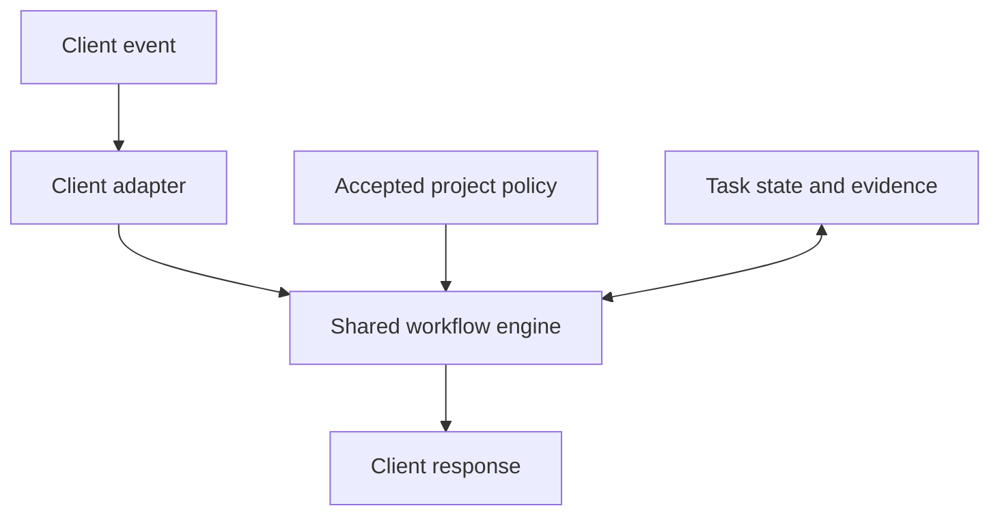

# Onboard my Project

Design and implementation plan · 26 October 2026 · **Stages, feature baseline, activation behavior, client scope and all eleven policy contracts approved; D1–D5 implemented; qualification remains scope-specific**

Outcome: enroll a project once, then activate its agreed workflow during ordinary coding requests. Qualify each client's actual behavior. Codex startup, opt-in D2 task controls, D3 private inspect/plan, D4 approved apply/resume/rollback and D5 task evidence verification exist. D3 does not modify projects; D4 keeps enrollment pending until mandatory adoption qualifies. Dispatch and repository merge enforcement remain D6–D7 work.

Contract loading: [policy index](../policies/00-index.md). The user approved all eleven contracts on 25 October 2026.

Track draft approvals in development records; release packages include only approved contracts.

Contract approval does not establish client execution or project adoption. D1 startup qualification and bounded D2 native execution evidence are recorded separately.

D1 startup implementation is recorded in [Codex validation](codex-validation.md). D2 controls and bounded native observations are in [D2 validation](d2-validation.md); the bundled controlled Stop-held Interrupt case passed, while ordinary read-first correlation, desktop UI and model policy compliance remain unqualified.

The [concrete D2 plan](d2-runtime-plan.md) scopes native state, guards, invalidation, Stop handling and diagnostics. Superset remains optional; no backend integration or onboarding choice is added in D2.

The [D3 plan and validation record](d3-onboarding-plan.md) describe the implemented private inspect/plan workflow and its limits; D4 applies an approved plan. Native operation remains the default, with no Superset question during initial onboarding. Superset integration and the separate [Enable/Disable Superset skill](superset-feature-map.md#planned-project-control-skill) are **implementation suspended**. Their future design retains explicit disable restoring native routing for new tasks.

The [approved D4 plan](d4-onboarding-plan.md) covers recoverable apply/resume/rollback and verified Toolkit adoption. Its [validation record](d4-validation.md) separates implementation checks, disposable adoption and actual native startup observations; none alone establishes complete project readiness.

The [D5 implementation plan](d5-checks-and-reviews-plan.md) defines native check/review evidence and completion verification. Its [validation record](d5-validation.md) separates package tests, independent review and a real disposable native lifecycle, including stale-evidence rejection. The proposed [D6 plan](d6-native-delegation-plan.md) covers native workers; the [D7 plan](d7-repository-gate-plan.md) covers repository enforcement and their parallel delivery boundaries.

The planned [D10: Review my Project](d10-project-review-plan.md) adds requested project reviews with selected areas or Full Scan, safe local checks and separate installation/fix approvals. It accepts enrolled or unenrolled repositories; workflow health and context/token efficiency remain separate diagnostics.

The approved [D11: Workflow diagnostics](d11-workflow-diagnostics-plan.md) is the **last deliverable**: an on-request offline HTML projection of existing evidence, with honest coverage and measured gains. The [project/repository model](#project-and-repository-model) and [retention policy](#evidence-retention) below are approved planning extensions, not implemented enrollment or cleanup behavior.

The user authorized the same startup layer for the next clients. Claude Code now reuses the shared startup protocol; Superset is documented as a host for native adapters. See [Claude and Superset validation](claude-and-superset-validation.md). This advances startup support only; D8's full lifecycle qualification still follows the required runtime/onboarding slices.

## 1. Authority and scope

1. **Vibe Coding Toolkit defines the workflow.** [Prompt 12][setup] governs existing-project onboarding. Follow its complete applicable procedure and current catalog, including native harness evaluation. New-project creation and machine setup retain their separate entry points.
2. **The user's decisions define project-specific choices and extensions.** Automatic workflow controls, shared coordination and required merge review are our requested extensions. The toolkit itself excludes Git hooks, branch/worktree requirements and commit/push protections from ordinary setup. Do not introduce those as toolkit requirements.
3. **Official client documentation defines adapter behavior.** An unsupported capability remains unsupported.
4. **`vibe-setup` supplies implementation lessons only.** Reuse concepts after evaluation; implement small modules against the new contracts.

Reviewed toolkit revision: `790a895304e0c08b70a5b215c9d334f1c86b816c`. Secondary reference: `vibe-setup` at `aa72e11fd05252fbedc3258813b9c6144ddb3101`; both matched `main` during research.

For authoring, setup and reviewed updates, consult Toolkit as the workflow authority. For every new onboarding/update run, resolve current toolkit `main` once; read required sources at that revision outside the project and record it. Resume interrupted setup at its recorded revision. A trusted available copy may support offline setup with freshness explicitly unverified; unavailable sources block only dependent setup work.

Runtime uses complete, locally authored contracts and accepted project configuration. It requires no Toolkit checkout, permanent snapshot or upstream fetch, including agent-side policy reads after hooks. Keep source provenance and requirement coverage in the [maintenance source map](policy-sources.md), outside routine loading paths. Temporary source retrieval during authoring/setup is sufficient; do not ship a copied repository or mirrored prompt collection. Review Toolkit changes before updating contracts; never silently change an active task's rules.

## 2. Stages and policy decisions

The user approved these three stages, the feature tables, activation behavior below and all eleven policy contracts. Implementation choices for unbuilt stages remain proposals.

| Stage | Responsibility | Evidence |
| --- | --- | --- |
| **1. Installation** | Make the plugin's capabilities available in the selected clients | Package discovery and working required adapters, hooks, runtime and diagnostics |
| **2. Project Onboarding** | Resolve conflicts, adopt mandatory policies and configure their mechanisms for the selected project | Recorded decisions, qualified project configuration and complete toolkit coverage |
| **3. Runtime** | Evaluate adopted policies for each task and enforce their required actions | Applicability decisions and current check, review and completion evidence |

### Activation and communication

The [Scope contract](../policies/01-project-scope.md#authority-and-activation) defines activation and communication. D1 must verify enrolled, unenrolled and broken-integration behavior; silent activation does not establish integration health.

### Project Onboarding steps

The entry point is **Onboard my Project**, skill ID `onboard-my-project`; keep its entry instructions within 150 words. It calls the current upstream procedure and the plugin's small onboarding helpers.

| Step | Agent does | User sees |
| --- | --- | --- |
| Inspect | Resolve target, read instructions, classify features and adoption, identify policy conflicts, assess merge-gate feasibility, run safe baseline checks and perform [bounded source-file screening](#oversized-files-and-agent-context) | A feature table with requirements, adoption, evidence and conflicts, plus a concise source-structure assessment with its coverage limits |
| Decide | Select an onboarding mode when conflicts exist, then resolve unknowns without waiving required features | One focused question at a time, recommendation, impact and reversibility |
| Plan | Build the full toolkit coverage matrix and exact proposed changes | Reviewable design/plan, outstanding choices and applicable authorization |
| Apply | Execute approved changes in dependency order with recovery records | Progress and specific blockers |
| Prove | Check configuration, new-session loading, actual execution and reruns | Evidence, remaining limitations and next actions |

### Oversized files and agent context

**Approved planning extension · 28 October 2026.** Implementation and behavioral qualification remain pending. D3 owns the brief onboarding assessment; D10 owns separately requested detailed assessment; approved refactoring uses the normal development workflow. Reuse existing tooling, evidence and records rather than add a skill, audit engine or reporting store.

**Brief onboarding assessment.** Include a lightweight source-file size inventory and shallow assessment of likely agent-context impact within the selected Project. Limit all additional screening work to **five minutes total**, shared across every Repository in an umbrella. Include additional discovery, counting, command execution, structural inspection and reporting in that budget. There is **no fixed candidate-count cap**. Do not expand the time allowance during onboarding, ask for an extension, or reset it by switching repositories, resuming or repeating the assessment. Stop at the deadline and report incomplete coverage; additional analysis belongs to the separately approved detailed assessment. This budget does not shorten or waive mandatory onboarding baselines or quality checks.

Reuse relevant current lint results or lightweight local counting, following [Tests and Builds](../policies/05-tests-and-builds.md) for accepted thresholds, counting semantics and safe command selection. The policy's size reference is screening guidance when no project limit exists, not a newly enforced lint threshold. State generated, vendor, dependency and other exclusions. Existing path/byte/read limits still apply; keep snippets and command output bounded rather than ingest whole oversized files merely for screening. A size inventory may count more files than receive structural inspection.

Keep initial reporting concise. When many files are found, group findings by meaningful upstream/ancestor source folders **within each Repository**, rolling up to a readable level without merging repository authority or hiding coverage gaps. For each group distinguish known oversized-file counts from structurally inspected files, exclusions and unknown coverage. Give representative paths and sizes where useful; an uninspected group's structural impact stays unknown. Prioritize only within the observed sample, with supporting evidence and confidence. Consider responsibility mix, navigation difficulty, likely unrelated reading and change frequency when evidence is available; length alone does not establish context impact. Recommend the next assessment or possible refactoring direction, with rough effort/risk only when supported; otherwise say unknown. These judgments are estimates, not measured token savings or an exhaustive project ranking.

Completing the bounded attempt and recording its actual coverage satisfies this screening step. Oversized-file debt, partial screening caused by its limits, or declining optional follow-up does not by itself block enrollment. Preserve all existing mandatory gates, baseline-failure handling and enrollment qualification requirements; screening cannot waive them.

**Detailed assessment in Review my Project.** Offer a focused file-structure and agent-context suitability assessment under D10's Code quality area. Require separate explicit approval for its selected repositories, candidates and analysis scope; reuse matching existing approval without asking again. Onboarding and Full Scan do not automatically authorize this deeper assessment. Full Scan may still report ordinary code-quality observations. Recheck supplied shortlist/evidence freshness, then inspect selected responsibilities, dependencies, public interfaces and tests. Produce prioritized refactoring recommendations with proposed boundaries, sequencing, risks and verification. Unknowns remain explicit. Approval covers analysis only; retain D10's separate installation boundary and [reporting/retention restrictions](../skills/review-my-project/references/procedure.md#findings-report-and-retention), including bounded chat output while managed detailed-report retention remains unavailable.

**Refactoring through normal development.** Require another explicit approval for the concrete selected changes and scope. Accepting an assessment/report does not authorize implementation. Approved work can continue in the same chat with an explicit transition to ordinary planning, implementation, review and verification. Preserve behavior, APIs, validation, error handling, accessibility and relevant tests; establish a passing baseline for behavior-preserving refactors. Keep unrelated fixes outside scope.

D10's planned source-structure focus must be distinguished from workflow health, native usage collection and measured context/token-efficiency diagnostics, which remain D11's responsibility. No automatic diagnostics, periodic scan or refactoring campaign is added. These planning changes neither activate umbrella enrollment nor qualify current client behavior. D3 and D10's linked plans identify implementation owners, affected loading paths and acceptance cases; their existing evidence does not prove this extension.

### Installation capabilities

| Feature | Mandatory? | Installation establishes |
| --- | --- | --- |
| Plugin package and entry skills | Yes | Discovery of the workspace, onboarding and maintenance entry points |
| Client adapter and automatic hooks | Yes | Required events load and execute in each selected client; additional clients remain a separate choice |
| Workflow engine, state and diagnostics | Yes | Policy evaluation, durable progress and detection of broken integration |
| Configuration, update and recovery mechanisms | Yes | Planned changes, apply, resume and rollback |

Installation makes capabilities available. Project adoption and task compliance are established in their respective stages.

### Project policies and runtime decisions

**Mandatory policies are non-negotiable in every onboarding mode.** Adopt the policy and qualify its mechanism during Project Onboarding; evaluate its applicability during Runtime. Conditional execution never makes adoption optional. This approved feature baseline supplements the complete upstream catalog; no target project has been assessed.

| Feature / policy | Mandatory adoption? | Runtime decision or behavior | Project adoption |
| --- | --- | --- | --- |
| [Project Scope](../policies/01-project-scope.md) | Yes | Resolve the repository, instructions, permissions and task state | Not assessed |
| [Project Onboarding](../policies/10-project-onboarding.md) | Yes | Assess the complete catalog, required integrations, equivalents and justified exclusions; qualify enrollment | Not assessed |
| [Task Planning](../policies/02-task-planning.md) | Yes | Determine planning depth and completion criteria | Not assessed |
| [Tests and Builds](../policies/05-tests-and-builds.md) | Yes | Select relevant checks and require current results before completion | Not assessed |
| [Security Review](../policies/04-security-review.md) | Yes | After implementation, assess actual changes and require applicable security coverage before completion or merge | Not assessed |
| [Code Review](../policies/06-code-review.md) | Yes | Review requirements, behavior and regressions before every merge; determine independence and specialist involvement by risk | Not assessed |
| [Agent Delegation](../policies/03-agent-delegation.md) | Yes | Preserve the user's coordinator settings; select worker model/effort from refreshed local platform guidance; coordinate ownership and bounded recovery | Not assessed |
| [Context and Handoff](../policies/07-context-and-handoff.md) | Yes | Update affected records and preserve enough context for reliable continuation | Not assessed |
| [Merge Readiness](../policies/08-merge-readiness.md) | Yes | Permit a merge only after applicable checks and reviews pass for the current changes | Not assessed |
| [Workflow Maintenance](../policies/09-workflow-maintenance.md) | Yes | Revalidate affected capabilities after relevant changes and investigate observed failures | Not assessed |
| [Tool Integrations](../policies/11-tool-integrations.md) outside required scope | No | Use selected additional integrations with their prerequisites; required catalog/project capabilities remain mandatory | Not assessed |

Security Review covers security; Code Review covers general requirements, behavior and regressions. Neither requires a separate specialist agent for every change. Stack-specific tools follow the complete onboarding assessment, including its default native evaluation method. Capabilities and implementation choices remain distinct: durable state is required; SQLite is proposed.

### Readiness and evidence

Track three facts separately: **policy adopted and mechanism qualified**, **action applicable**, and **action satisfied**. A policy-based reason may make an action inapplicable. Missing prerequisites, unavailable reviewers or failed checks cannot provide that reason. Unknown applicability remains unresolved; it cannot count as satisfied.

Proposed feature records: `id, stage, mandatory_adoption, basis/source, execution_rule, adoption, verification, evidence_or_blocker`. Stage values are `installation`, `project_onboarding` and `runtime`. Adoption is `not_assessed`, `adopted`, `reused_equivalent`, `not_adopted` or `blocked`; verification is separate (`not_run`, `passed`, `failed`). Runtime decisions record the policy/task identity, applicability, reason, required actions and current evidence. Installed/configured alone is insufficient; existing equivalents require behavioral evidence.

**Project readiness:** apply the [mandatory-adoption rule](#project-policies-and-runtime-decisions) throughout the accepted scope. Missing adoption or mechanism qualification leaves Project Onboarding incomplete, with the blocker and remedy. Qualification proves the policy can operate; it does not require executing every possible future review or preapprove any future task. Runtime enforces triggered actions again. An unavailable required specialist blocks dependent completion or merge while independent authorized work continues. Optional omissions may remain explicit.

### Choose how to handle existing policies

Use the [scope contract's conflict rules](../policies/01-project-scope.md#when-instructions-conflict) for the three modes, required decisions and runtime boundaries.

Record `onboarding_mode`, repository/client scope and the decision reference in project policy. The enrollment journal binds authorization to the reviewed migration scope. Optional omissions use `not_adopted` with reason `deferred_by_user_policy`; required conflicts remain `blocked`.

**Proposed replacement boundary, awaiting refinement:** replace the selected project's AI workflow instructions, hooks and agent configuration; retain product requirements, application code, architecture constraints, credentials and unrelated tooling. Shared/global integrations require separate scope decisions. The mode does not override host or organization controls, or authorize new costs and production changes.

“Replace” means the entire legacy workflow layer within that scope, including compatible old process rules, rather than only conflicting rules. Working tools may be reused under the new policy. List preservation exceptions in the migration preview so the resulting workflow has one clear authority.

Archive whole files only when they contain exclusively superseded workflow material. For mixed files, back up the original and replace only reviewed sections. Keep backups outside the repository and client instruction/skill discovery paths; record original locations, hashes and restoration steps. Retire obsolete hook registrations as well as their files, then verify behavior in a new session. Rollback preserves subsequent user edits through the existing conflict checks.

The agent identifies semantic conflicts; scripts validate and apply recorded resolutions under the scope contract.

### Questions within the selected mode

Use the [scope contract's decision rules](../policies/01-project-scope.md#when-instructions-conflict). The following record format and question transport are proposed implementation details.

Record each material decision as `id, scope, options, selected_value, provenance, status, affected_actions, invalidation_trigger`. Provenance distinguishes user confirmation, existing project rules, observed facts and assumptions. Status is `confirmed`, `inherited`, `proposed` or `pending`. Store the evidence/reference behind inherited choices. The enrollment journal also binds approvals to a design/plan digest, scope and user-message reference. Material revisions reopen only affected decisions and approvals.

Use the host's question UI when available and ordinary conversation otherwise. Hook subprocesses never attempt an interactive questionnaire. In a noninteractive run, return the pending question and continue independent authorized work.

## 3. Architecture

Keep shared workflow contracts in `policies/`, entry skills in `skills/`, and design, plans and source mapping in `docs/`.

The [Superset feature map](superset-feature-map.md) preserves future host integration decisions and dated capability findings. Superset implementation is suspended; consult it when that work resumes, not for native D6 execution.

### Client scope and adapter organization

Support targets are Codex, Superset, Claude Code and Claude Desktop's Code and Cowork surfaces. Claude Chat is out of scope. Keep client implementations under `runtime/adapters/`; add modules or subdirectories only when implementing that client. Share policy and procedures, loading only the adapter instructions needed for the current task.

Codex and Claude Code share the compatible `SessionStart` JSON subset in `runtime/adapters/session_start.py`, with a thin module per native client. Superset launches those agents rather than supplying another startup protocol; preserve that distinction and qualify its launch/permission behavior separately.

Organize client interface specifications under `clients/`, using `index.md` and descriptive client names such as `codex.md`. No numeric prefixes are needed.

The index identifies each client's scope and when to load its specification. Add files with their implementation slice, without empty placeholders. Runtime modules retain language-appropriate names under `runtime/adapters/`.

Qualify Desktop Code and Cowork separately; reuse Claude Code behavior where capabilities match. [Desktop local/SSH Code sessions support plugin installation](https://code.claude.com/docs/en/plugins/install). [Cowork supports hooks and subagents](https://support.claude.com/en/articles/13837440-use-plugins-in-claude). Package availability alone does not establish full workflow support. Missing mandatory mechanisms keep that surface unqualified under the existing readiness rules.



**Proposed runtime:** Python 3.11+ and its standard library, including SQLite for local coordination. Detect the interpreter; a missing runtime becomes a workspace prerequisite. Keep code in the installed plugin. Project repositories receive policy and necessary documentation/configuration, without duplicated runtime scripts.

| Component | Responsibility |
| --- | --- |
| `runtime/adapters/codex.py` | Probe the actual client surface/version; normalize Codex events; render supported responses |
| `runtime/adapters/claude_code.py` | Later, provide the same contract through Claude's native mechanisms |
| `runtime/engine.py` | Evaluate accepted policy and task state; return decisions without host-specific JSON |
| `runtime/state.py` | Short transactions, event deduplication, task identity and resource ownership |
| `runtime/onboarding.py` | Inventory, source revision, decision records and coverage plan |
| `runtime/changes.py` | Planned edits, fingerprints, backups, apply/resume/rollback |
| `runtime/evidence.py` | Check/review provenance, freshness and completion requirements |
| `scripts/workflow.py` | One command entry point for hooks, diagnosis and enrollment operations |

Add modules only with their deliverable. Avoid an SDK, daemon, dashboard or separate orchestration service at this stage.

### Adapter contract

```text
probe(target)                 -> capabilities + observations
normalize(native_event)        -> Event | UnsupportedEvent | InvalidEvent
evaluate(event, policy, state) -> pass | deny | context | pending_decision
render(result, native_event)   -> stdout JSON + exit status
plan_config(existing)          -> owned edits + conflicts + validation
```

`Event` contains a schema version, client/surface/version, native event and call IDs, session/actor identity, resolved repository/worktree, operation and observable settings. Missing data stays unknown. Internal `pending_decision` is never blindly serialized as a client hook response. `pass` preserves the client's existing permissions; it does not grant additional access.

Capabilities distinguish `documented`, `configured`, `trusted`, `observed` and `unsupported`. Qualification is bound to client version, surface, adapter/runtime digest and relevant configuration. A successful mock is not observed client execution.

`doctor` runs independently of the hooks it diagnoses. Missing, disabled or untrusted hooks and changed qualification inputs invalidate current protection claims; old observations remain history. Where current trust or execution cannot be observed, report unverified.

### Persistence

| Location | Contents |
| --- | --- |
| `.vibe-coding-workflow/project.json` | Versioned project ID, schema version, accepted feature requirements/adoption and policy, onboarding mode/scope, source revision, selected clients and canonical-document mappings |
| Existing canonical project docs | Toolkit setup record, decisions that affect architecture, quality commands and maintenance; reuse upstream's nine-destination map |
| One machine-local data directory | Enrollment journals, private backups, capability evidence and SQLite task/ownership state; shared by qualified clients |

The shared data directory is selected during enrollment and stays outside Git and plugin installation caches. Do not assume two vendors' `PLUGIN_DATA` directories share state. Exclude secrets and raw transcripts from routine records. Use SQLite only on a supported local filesystem.

### Project and repository model

**Canonical owner: D3/D4 enrollment and startup/identity follow-up.** A **Project** is the onboarding and reporting unit: either a standalone Git repository or an explicitly selected umbrella folder, such as PHIOON, with member repositories. Each **Repository** retains its own code, quality checks, candidate/revision identity and merge evidence. D10 and D11 consume this single membership authority; neither creates another registry or infers membership from a report.

Explicit umbrella onboarding covers current member repositories and authorizes automatic joining of future repositories within standing approved scope. Normal task-entry coordinator preflight owns a matching repository's bounded D3 assessment/proposal and D4 recoverable adoption under recorded standing authority, before dependent task writes and without repeated approval. Startup stays read-only; hooks only report pending/unresolved membership. Uncovered permissions, costs or conflicts block only affected actions. Record canonical umbrella/member paths, boundaries and exclusions; bound discovery to the registered scope, with no recursive scanning service. Ordinary parent ancestry grants no enrollment authority; canonicalize paths and reject symlink escapes.

Distinguish stable Project, Repository, checkout/worktree and task identity. Initially each Repository has one authoritative Project. Resolve linked worktrees through common-Git metadata to the primary checkout/shared-guide location; the temporary worktree's parent is not the umbrella. Separate clones, moves, standalone-to-umbrella transitions and overlapping umbrellas require identity/authority reconciliation, preserving historical attribution. Do not guess from paths or remote URLs, duplicate membership or silently transfer a Repository between Projects.

Reuse explicit shared-guide pointers and established precedence instead of copied workflow prose. Shared workflow supersedes obsolete workflow copies; repository product rules, publication authority, local settings, permissions and active-task pins remain binding. Do not copy preferences, mirror declarations or create an `AGENTS.override.md` inheritance engine. Identify the actual executing hook source/harness root separately from the software repository, command directory and every relative-path base. Hook configuration belongs to its actual owner; a shared instruction update does not upgrade member scripts/settings. Check identity, policy/runtime/schema and client compatibility before active claims. Actual loading/execution and mechanism qualification remain observed per client/repository, never inherited from umbrella or sibling success. Show joined/configured, pending, active and qualified facts separately.

Applicable lint belongs to approved onboarding at the real dependency/package-workspace owner. Reuse equivalent tooling and current results; install missing applicable tools during approved onboarding at that owner. Run commands at the actual application directory, such as `admin/web`. Do not add universal ESLint/Pylint dependencies, duplicate file-size checks, redundant lint runs or an Actions dependency. D10 installations keep their separate approval boundary.

**Implementation boundary:** D3 supports explicit Project-scope private inspection/proposals while legacy input keeps its one-checkout path. Private plan schema 2 is not schema-2 enrollment: D4 rejects it before transaction validation, worktree locks or journal creation, and startup still reads checkout-root schema-1 enrollment only. Canonical membership/adoption, automatic joining and runtime/evidence identity integration remain the bounded follow-up below. Package/private-plan proof does not qualify live adoption or client execution.

| Owner / existing implementation seam | Required follow-up and loaded instruction owners |
| --- | --- |
| D3 — `runtime/onboarding.py`, `scripts/workflow.py` | Normal task-entry coordinator preflight assesses approved standalone/umbrella scope, current members/exclusions, standing join authority, identity conflicts, shared-guide/hook owners and real lint owners in the exact proposal. Carry into `policies/01-project-scope.md`, `policies/10-project-onboarding.md` and `skills/onboard-my-project/references/procedure.md`. |
| D4 — `runtime/changes.py`, enrollment in `runtime/startup.py` | Task-entry coordinator preflight applies recoverable adoption before dependent writes, membership changes and shared/member update separation using owned baselines; carry into policies 01/10 and `skills/onboard-my-project/references/apply-and-recovery.md`. |
| Startup/state — `runtime/startup.py`, `runtime/state.py`, native adapters | Resolve registered membership/common-Git identity read-only; compatibility before active claims. Carry actual hook owner, path bases and client observations into `clients/startup.md` and `clients/runtime.md` under policy 01. |
| D5 — `runtime/evidence.py`, accepted command/evidence controls | Repository-bound candidate/check/review proof, real command cwd, linked-task implementation status and safe ledger retirement; `policies/05-tests-and-builds.md`, `policies/06-code-review.md` and `clients/evidence.md`. |
| D6 — `runtime/delegation.py`, `runtime/state.py`, existing reconciliation | One editable software repository/worktree per worker, shared-resource claims and write/report/recovery coverage; settled-history retirement without hiding owners. Carry into `policies/03-agent-delegation.md`, `clients/delegation.md` and `clients/runtime.md`. Current package controls do not prove these new seams. |
| D7 — `runtime/repository_gate.py`, `scripts/repository_gate.py` | Keep each target gate/merge authority; consume complete required companion delivery links with D5. Carry into `clients/repository-gate.md` under Merge Readiness; no group gate or transferred merge permission. |
| D9/D10/D11 — existing qualification, review and reporting owners | Require affected membership/evidence seams before umbrella claims; D10 temporary review scope grants no enrollment; D11 projects lifecycle-owned evidence and remains last. Independent repository work and explicit unknown states remain possible. |
| Source-to-contract coverage owner — `docs/policy-sources.md` | Trace approved extensions and PHIOON implementation references separately from Toolkit authority; update affected local contracts during implementation, not by claiming this plan loads or implements them. |

Future release acceptance must exercise selective loading and complete applicable requirements across these owners: standalone/future umbrella joining without startup writes; exclusions/symlink escapes/common-Git worktrees/clones/overlaps and preserved preferences; actual hook owner and command cwd; one-repository worker write/report/recovery scope; linked failed/stale/unmerged companions with manual merge preserved; rollback after later joins/user edits/active pins; temporary unenrolled umbrella review; and settled history beyond 4096 with uncertain owners, required references and all retention protections intact. Reuse applicable prior evidence and qualify changed seams only; word counts or package validation alone do not prove behavior. Native and repository-enforcement observations remain separate.

### Cross-repository tasks and delivery

One logical request links existing repository-scoped D5/D6 tasks in the existing task plan. Keep every member's candidate/revision/check/review proof; add only shared acceptance criteria, the complete required companion links and derived aggregate status. D5 implementation verification requires both the shared acceptance criteria and current proof for each member; D7 supplies per-target delivery observations. **Implementation verified** and **delivery complete** are separate: every explicitly required companion PR must be observed merged before delivery is complete. A failed/stale member blocks implementation acceptance; an open/unmerged or unverifiable required PR blocks delivery. Work requiring no publication can satisfy implementation without counting as a merged required PR. The coordinator owns complete links and fresh observations before the claim; no group registry, second orchestrator or atomic cross-repository merge abstraction is added.

Initially each worker has one identified Repository/worktree as its editable software scope; split multi-repository requests into linked jobs. Declare shared resources separately and keep Git operations and shared workflow files coordinator-owned. Do not admit writes beyond report/recovery coverage, including foreign Git metadata. Reuse the existing shared ownership ledger and conservative serialization, retaining limitations for unknown aliases/resources and uncontrolled writers; absolute claims alone do not prove cross-root effect coverage. Merge assurance remains per repository/target and never transfers publication permission: preserve local authority, including PHIOON's manual-merge preference, without making that preference universal.

### Membership updates and recovery

D4 reuses owned baselines, journals and recovery checks. Separate shared-policy updates from member runtime/script/settings updates, preserving active pins until compatible update/reconciliation. Recover affected members independently while honoring shared dependencies. Removing membership stops future activation but retains needed proof and active/uncertain ownership. Before shared-policy rollback, reconcile all dependent members/tasks, later joins and user edits; no blanket restore or silent rebind is permitted. Existing D4 stopped-writer and postimage checks still apply to affected mutation.

### Evidence retention

**Canonical owner: existing private evidence/state lifecycle owners; D11 consumes their results.** This approved policy applies to plugin records, not existing native history or onboarding backup/recovery policies. Use the existing private state outside Git and plugin caches; add no duplicate measurement ledger, background agent, schedule or GitHub Actions job.

| Record class | Limit and retained content |
| --- | --- |
| Compact closed-task records | At most **four months** of task measurements, authoritative numerical source receipts, provenance, corrections, coverage, compact verification and a short outcome summary reused from normal completion. Retain enough authoritative numerical evidence to reconcile reported totals; hashes alone are insufficient. Add no summarizer. |
| Detailed closed-task evidence | Briefs, review reports and useful diagnostics expire **seven days after safe closure**: workers reconciled and no pending execution, merge or recovery dependency. |
| Detailed evidence size | **100 MiB per Project** of closed-task detailed evidence, shared across every repository in an umbrella. Evict oldest eligible evidence first for age or size. This is not a separate allowance per repository. |
| Protected evidence | Active, uncertain, merge-required or recovery-required evidence is exempt from both time limits and the size cap, including the four-month compact limit. Surface protected excess and its dependency; preserve proof until safe to release. |

Before deleting detailed text, separate and preserve the durable compact proof needed to reconcile numerical reports. After compact expiry, do not claim totals or validation that no longer have sufficient support. Avoid dangling source links and fresh validation claims after supporting evidence expires; label unavailable/expired detail honestly. Keep only needed non-content expiry metadata. Diagnostics add no full transcripts, context windows or repeated source copies, and make no universal redaction claim.

Temporary unenrolled reviews store canonical target-to-evidence-owner references in existing private evidence metadata for stable non-enrolling retention accounting under these limits. Repeated, subset or aliased reviews reuse reconciled owner(s), original ages and allowances; a request creates no fresh 100 MiB allowance. Enrolled members keep their Project accounting/authority. Overlapping targets neither silently reparent evidence nor allocate another allowance; unresolved identity limits detailed retention instead of bypassing the cap. Add no registry or enrollment.

Safe closure is distinct from `ready`: it cannot occur while execution, merge or recovery dependencies remain, including proof needed by a linked companion. Existing D2/D5/D6 state/evidence/reconciliation owners must safely retire eligible settled task history and assignment-ledger history so their current **shared-state-authority-wide** 4096 lifetime inspection bounds cannot eventually block every task; these are not per-Project limits. Inspection bounds must cover relevant live/dependency owners; never truncate or drop an uncertain owner. If every record remains needed, preserve all of them and block dependent new admission while allowing bounded truthful read-only status/recovery; never switch database/authority to evade the bound. Preserve replay safety, historical findings/required references and authoritative compact proof until eligible expiry; keep unknown or dependency-bound owners live. Compact retired identities retain replay/reference safety without becoming reusable passing evidence. Retain only needed non-content identity/expiry markers, which cannot resurrect expired validation. Do not bypass uncertainty through a new database, duplicate ledger or missing-proof success.

Perform bounded deterministic cleanup during normal use and physically delete eligible content at the next opportunity; no background execution is implied. Managed snapshots/exports must not quietly preserve expiring detailed text beyond this policy or evade the Project cap. Reports are dated projections, not fresh source proof; use compact projections where detailed-export retention cannot be maintained and disclose copy/retention limits. Exact four-month boundary and correction/age-reset semantics remain narrow implementation details to document and test without weakening these limits or protected dependencies.

Bind active tasks to policy, source and runtime versions. Defer incompatible enrollment/runtime/state-schema updates until affected writers are confirmed stopped; then reconcile pending tasks and evidence. Never silently switch an active task's rules. Other clients using shared state must pass schema/version compatibility checks.

## 4. Hooks and enforcement

| Native event | Intended behavior | Limit |
| --- | --- | --- |
| `SessionStart` | Resolve enrollment; inject a short policy pointer and outstanding state | Unenrolled repositories receive no workflow changes |
| `PreToolUse` | Check supported guarded actions, approved task scope and resource claims | Unknown tool paths are not advertised as protected |
| `PostToolUse` | Record observable results and mark affected evidence stale | A completed action cannot be undone by this hook |
| `SubagentStart` / `SubagentStop` | Correlate workers and observed lifecycle | A start event alone is too late to prevent dispatch |
| `Stop` | Check explicit task completion state; request a bounded continuation when useful | Never loop on unanswered questions, cancellation or external blockers |

Use host-specific hook files, such as `hooks/codex.json` and later `hooks/claude-code.json`, with explicit manifest references. Inspect existing interceptors and preserve RTK or other working integrations. Register each handler once.

Runtime rules:

- Validate a top-level JSON object and event-specific fields; bound input size and execution time. Serialize only supported responses.
- Keep the fast path local: no upstream fetch, model call, full test suite or expensive rescan per event. Inject context on relevant transitions; unchanged events normally emit nothing.
- Orientation failures produce a short diagnostic. Failure of a required check prevents a success/ready verdict. A live guard denies an affected action only through a mechanism proven to block in that client; timeout or missing-hook behavior must be measured separately.
- Keep transactions brief. No model, network or long-running process executes while holding a state lock.
- Track native call IDs where available. Handle duplicate and out-of-order events without double-applying state changes; use idempotent transitions when the host supplies no unique event ID.
- Default to at most one automatic continuation for the same unresolved stop condition. Respect smaller user limits and explicit pauses. Ending with `blocked` or `awaiting_user` remains valid.

**Verified platform constraints:** Codex requires trust of the current plugin hook definition. Its current `PreToolUse` does not support `permissionDecision: "ask"`; that response can fail the hook and allow the tool to continue. Cloud-orchestrated ChatGPT Work does not support plugin hooks. Qualify local Codex first, and show unsupported surfaces honestly. Claude has different output and registration semantics. [Client sources: 4–7 below.]

### Evidence, general review and Security Review

Task states: `planned`, `active`, `awaiting_user`, `blocked`, `verifying`, `ready`, `cancelled`. Within the runtime API, only the verifier can transition to `ready`; an agent's success message is insufficient. Accept independent review provenance from a correlated reviewer execution observed by a qualified adapter, or a trusted external integration. A report's own claimed identity cannot establish provenance. Local records protect workflow integrity; they are not a security boundary against processes with the same filesystem permissions. Repository enforcement has a separate trust boundary below.

Bind results to the candidate content, base revision, relevant check definitions, policy digest and reviewer/executor provenance. Account for staged, unstaged and relevant untracked content; HEAD alone is insufficient. A change to those inputs invalidates affected evidence. Recheck actual content before completion because a missing hook must not preserve stale success.

The [Review contract](../policies/06-code-review.md#choose-coverage) defines general coverage and risk-based independence. The [Security Review contract](../policies/04-security-review.md) defines its separate timing, scope and blockers; [Tests and Builds](../policies/05-tests-and-builds.md) defines proof and freshness. The runtime must implement these decisions without treating an unavailable required reviewer as inapplicable.

Worker routing follows the approved [Delegation contract](../policies/03-agent-delegation.md). Cross-vendor execution is a later integration, not an assumed feature of a hook adapter.

### Ownership and merge assurance

The [delegation contract](../policies/03-agent-delegation.md#ownership-and-parallel-work) defines ownership, parallelism and recovery. D6 implements transactional reservations and qualifies which restrictions the client actually enforces.

The [Merge contract](../policies/08-merge-readiness.md) defines the repository gate, trusted evidence, bypass/queue qualification and authorized merge behavior. D7 implements and qualifies those controls; client hooks alone do not establish repository enforcement. [GitHub sources: 8–9 below.]

## 5. Small deliverables

Each deliverable receives its own reviewable change and evidence. Unit/fixture validation and actual client qualification are reported separately. A missing target client does not prevent implementing independent slices.

| ID | Deliverable | Concrete output | Acceptance |
| --- | --- | --- | --- |
| **D1** | Codex adapter and startup hook | Event contract, root resolver, `codex.py`, `hooks/codex.json`, dispatcher and manifest wiring | Nested/worktree fixtures resolve correctly; unrelated repo is untouched; a real installed/trusted hook loads the policy once |
| **D2** | Deterministic hook runtime | Local state, guarded-action responses, post-tool invalidation, bounded Stop handling and `doctor` | Actual denial blocks; pass preserves native permissions; missing/untrusted/disabled hooks, crash and timeout produce honest health; pending decisions cause no continuation loop or implicit permission grant |
| **D3** | Guided onboarding plan | `onboard-my-project` skill/procedure, inspect/plan CLI, private versioned plan and exact proposal schema; planned [source-file screening](#oversized-files-and-agent-context) | Three stages distinguished; full catalog covered; mandatory policies separated from conditional actions; no mode waives a policy; equivalents require evidence; merge feasibility established; screening stays bounded with grouped, truthful coverage |
| **D4** | Reversible Project Onboarding and toolkit adoption | Transaction module, approved component execution, mode-aware configuration/docs, inactive backups, `apply`, `resume`, `rollback` | Missing mandatory policy/mechanism qualification prevents readiness; future task evidence remains separate; required conflicts resolve or block; recovery preserves unrelated content |
| **D5** | Checks, general review and security review evidence | Accepted check/review policies, applicability decisions, check runner and completion verifier | Security review runs after implementation with no planning-time review gate; every merge receives general and applicable security coverage; missing/stale required evidence or blocking findings prevent readiness |
| **D6** | Native worker routing and concurrent ownership | User-selected coordinator settings, cached worker guidance, bounded dispatch, atomic reservations and stop reconciliation; [canonical worker-control plan](d6-native-delegation-plan.md) | Duplicate requests and ambiguous launch outcomes cannot produce a second managed writer; fifteen conflicting claims have one winner; bounded retries preserve partial work and uncertain ownership until verified stop/descendant reconciliation; coordinator settings stay unchanged; Superset absent |
| **D7** | Real repository merge assurance | Trusted final verifier, repository-enforced gate, disposable rejection/acceptance proof and separately authorized live rules; [canonical gate plan](d7-repository-gate-plan.md) | Actual supported merge paths reject missing/stale/failed evidence and accept a legitimate current candidate; bypasses and queues are qualified where applicable; local readiness cannot establish enforcement |
| **D8** | Claude Code adapter | Native manifest/config adapter and shared contract fixtures | The same scenarios pass in an actual Claude session; no duplicate handlers or policy fork; settings evidence remains truthful |
| **D9** | Behavioral qualification, native usage reporting and PHIOON pilot | Reusable native harness cases, reconciled task-consumption report, then one Python and one Next.js repository and a bounded cross-repository task; [D9 sequence](#d9-qualification-usage-and-pilot) | Evaluator rejects deliberately broken workflow behavior and accepts its correction; native coordinator/worker usage reconciles through verified acceptance without omissions or double counting; ordinary requests activate the qualified workflow |
| **D10** | Review my Project — planned | `review-my-project` entry point and selectively loaded procedure reusing project tooling and installed review capabilities; planned focused source-structure assessment; [canonical review plan](d10-project-review-plan.md) | Selected scope stays selected; Full Scan reports bounded actual coverage; safe checks are deduplicated; detailed source-structure assessment, tool installation and selected fixes retain separate approvals; unenrolled repositories remain unenrolled |
| **D11** | Workflow diagnostics — planned, last | On-request local self-contained offline HTML using existing authoritative evidence; [canonical diagnostics plan](d11-workflow-diagnostics-plan.md) | All Projects/Project/Repository filters update every panel; coverage and attribution stay honest; gains have comparable baselines; retention preserves required proof; safe accessible rendering works without rerunning checks |

Sequence: **D1 → D2 → D3 → D4 → D5**, then parallel D6 and independent D7 verifier work after their interface agreement; D7 enforcement qualification follows reviewed D6 integration. D3–D5 are implemented; consult their validation records before advancing qualification claims. D8 can follow D4 independently. D9a prepares behavioral qualification after D5/D6 and may run alongside D7 with independent resources; D9b usage collection follows D7's disposable enforcement proof, then D9c pilots the qualified capabilities. D7 live settings receive separate review/authorization before protected pilot merges. Real merge assurance is a release requirement and takes priority over usage analytics. Unsupported telemetry blocks D9b acceptance, not independent gate delivery. Multi-repository rollout follows the pilot; automatic joining requires the explicit approved umbrella scope above, never ordinary parent ancestry or an assumed enrollment of all nine repositories.

D10 is a separate future deliverable, not a dependency blocking active D6/D7 or a mandatory enrollment step. It may reuse current D5/D6 evidence when available; standalone review does not require enrolled runtime state.

**D11 is delivered last, after the preceding deliverables' accepted slices.** Its scoped projection, HTML and qualification work reuse their evidence owners and the canonical membership/retention follow-up above. Unknown or unqualified client capabilities must render honestly; delivery does not require universal success across every client. D11 does not reopen D6 worker controls, D7 enforcement or the approved task-based worker-selection policy.

Superset integration and its Enable/Disable skill remain **implementation suspended**, outside D6. Resume them only when requested, preserving the [future control contract](superset-feature-map.md#planned-project-control-skill). Scope Claude Desktop surfaces separately after capability discovery; do not infer their qualification from D8. Qualify the implemented D1 startup slice before extending the runtime.

Keep the larger items reviewable:

- **D3a:** mandatory policy adoption, separate runtime applicability, conflict inventory and mode selection. **D3b:** complete the plan under the selected mode. Validate required and optional conflicts, a verified equivalent, a missing prerequisite, a duplicate integration, a mixed instruction file and a shared policy. Mode 1 asks how to satisfy requirements, mode 2 preserves compatible behavior and blocks required conflicts, and mode 3 proposes scoped replacement. Every mode rejects missing mandatory policies as ready; a task's inapplicable specialist action does not disable its policy.
- **D4a:** transaction engine and disposable recovery tests. **D4b:** execute approved toolkit adoption through upstream procedures, one dependency group at a time. Include applicable installations/updates/reuse, quality work, integration checks and initial native harness evaluation. A configuration-only result cannot mark adoption complete. Blocked components retain their exact resumption condition; do not build a parallel catalog of custom installers.

### D7: Repository merge assurance

**Canonical owner: repository-gate worker, with independent security/review verification.** D7a delivers the trusted verifier, D7b proves rejection and legitimate acceptance in a disposable repository, and D7c adopts separately reviewed live rules. D5 supplies candidate-bound evidence; D6 supplies writer reconciliation. Exact files, source-trust prerequisites, parallel ownership and completion evidence live in the [D7 implementation plan](d7-repository-gate-plan.md), implementing [Merge Readiness](../policies/08-merge-readiness.md). Hooks and local readiness never establish repository enforcement; an unavailable required control leaves that scope incomplete.

### D9: Qualification, usage and pilot

Toolkit remains the authoring authority. This phase packages the existing [native harness procedure](../policies/09-workflow-maintenance.md#requalify-affected-behavior) into reusable qualification and reporting; it creates no second worker-control or merge-gate phase.

| Subdeliverable / canonical owner | Dependencies | Completion evidence |
| --- | --- | --- |
| D9a — behavioral qualification / qualification worker with independent evaluator | D5 evidence/fixtures; D6 worker controls; D8 only for Claude lifecycle claims | Protected evaluator, fixed inputs and observed negative/corrected runs for selected native cases; surface/version/capability/workflow-revision qualification record. |
| D9b — native usage reconciliation / measurement worker with independent source reconciliation | D5 verified acceptance, D6 coordinator/worker/attempt identities, qualified native usage source; delivery follows D7b | One native-only coordinator/worker/reviewer task reconciles to authoritative observations, including failures, retries/resumes and verification overhead; replay and missing-data cases pass. |
| D9c — PHIOON pilot / pilot coordinator | D9a and D9b accepted for the selected capabilities, D7c before protected merges, applicable client qualification | Python and Next.js repositories plus one bounded cross-repository task; ordinary activation, worker controls, repository gates and measured overhead demonstrated. Umbrella claims require the canonical membership/startup follow-up. |

**D9a behavior:** cover Toolkit's seven cases—boundary fix, stale handoff, read-only review, setup reapplication, worker/resource conflict, partial blocker, and pause/resume—where the adopted capabilities apply. Record unavailable observations as not run, not inapplicable. Use credential-free disposable copies, Toolkit fixtures/evaluator from one pinned revision and D5 artifacts where suitable. Protect the evaluator and original inputs from worker writes and retain their digests. Reuse D6 conflict/duplicate/interruption evidence and D7 repository proof through links; D9 owns the cross-capability qualification result.

Prove a negative control for workflow behavior itself: deliberately violate a selected criterion, such as accepting a stale handoff without verification, and show that independent observation rejects it. Then run the corrected behavior from the same inputs with the same evaluator and comparable settings. A broken application fixture alone does not prove this workflow criterion. Keep one bounded baseline/candidate change, inspect actions and diffs independently, and recheck the known-broken control whenever the evaluator changes. Package tests and agent self-reports cannot establish native behavior.

Bind results to client surface/version, capability, workflow revision, evaluator/input digests and observed execution settings. Record pass/fail/not run separately from qualification: qualified only with sufficient current proof; stale after relevant invalidation; unobserved when native observation is missing; failures remain explicit. Fresh subagents do not prove restarted-client behavior. Preserve unrelated passing evidence without claiming a universal reliability rate.

**D9b consumption:** qualify the source and its attribution semantics before aggregating. Reuse a qualified measurement facility or existing private immutable artifacts and identities; no second ledger or mandatory local-model plugin. Existing hook receipts and consumed dispatch budgets are not native usage telemetry. The task report covers coordinator work, every worker attempt, failures, retries/resumes, review, verification and integration through verified acceptance, with a declared collection cutoff and late observations reconciled before claiming completeness.

Use stable task/worker/attempt/source/run identities and idempotent ingestion. Distinguish cumulative snapshots from incremental records, inclusive parent totals from disjoint child totals, and cache/reasoning subsets from additional usage. Prefer a qualified inclusive total; otherwise sum only complete, proven-disjoint components. Never add included worker usage or subsets twice. Qualify mixed-model/provider attribution separately; availability of a record format does not qualify collection. Retain conflicting/corrected observations and source history. Missing workers, unsupported metrics or uncertain attribution remain unknown/incomplete, never zero or text-length estimates. Report known subtotals and missing coverage. Prove replay, cumulative/incremental updates, retries/resumes, overlapping totals, delayed observations and missing-data cases against a real native task. Token or monetary savings remain unmeasured until supported by a valid comparison.

Qualification and usage results produce evidence and proposed fixes. They do not automatically adjust projects, launch periodic analyzers, or change model/provider preferences or routing policy. Any project fix needs its own existing or explicit authorization. The approved task-based worker selection remains unchanged.

### First implementation slice: D1

Add only the dispatcher, Codex normalization/response module, root resolution, startup handler, fixtures and manifest reference. Use a disposable enrolled-project fixture. Extend the existing package validator to check hook paths. Keep enforcement handlers for D2.

Implemented with the [Codex client contract](../clients/codex.md). Native probes required the sole `.codex-plugin/plugin.json` compatibility manifest: the tested builds suppress hook discovery when root `plugin.json` exists. See [validation evidence and limits](codex-validation.md) before reusing the pattern.

Implementation steps:

1. Normalize documented `SessionStart` payloads and resolve the nearest Git checkout, including linked worktrees. Check nested, neighboring and inherited-environment cases.
2. Read only that checkout's enrollment record. Require matching checkout/common-Git identity, selected client and local policy digest; copied or stale records must not activate another checkout. Use fixtures until D4 supplies enrollment.
3. Return a short local client/policy pointer for enrolled scope, nothing for unenrolled scope, and a diagnostic for invalid integration. Wire one manifest handler with bounded input and execution; test malformed input, missing files and unchanged permissions.
4. Run package and behavior checks, then observe installed hook discovery, trust and execution in an isolated real Codex process. Report that evidence separately from desktop UI and model behavior.

Run package validation, fixture checks, `git diff --check`, then a real new-session startup probe on the target client. Record client surface/version and hook trust. If that client is unavailable here, report the live probe as not run. Do not change PHIOON as part of D1.

Check the [approved activation behavior](#activation-and-communication) in enrolled, unenrolled and broken-integration scenarios, distinguishing internal context loading from user-facing messages.

### Project Onboarding transaction rules for D4

Bind the apply plan to target identity, source/policy revision and before-file hashes. Back up changed owned content; write each file atomically and journal progress. Filesystem edits are not a single atomic transaction: recovery reconciles each applied operation. Resume from verified state. Rollback restores only content still matching the plugin's recorded output; concurrent user edits become explicit conflicts. Privileged/external changes remain separate operations with their own authorization and recovery.

## 6. Improvements to measure

| Reference lesson | Proposed improvement | Evidence |
| --- | --- | --- |
| Hooks copied into each project | One installed runtime and small per-project policy | Update touches runtime once; project customizations survive |
| Large instructions injected into workers | Short transition-specific context and on-demand references | Captured hook output size and observed tokens where available |
| Briefs declare writable files | Atomic ownership before managed dispatch | Concurrent conflict tests |
| Native logs treated as qualification | Capability-specific provenance and honest unknowns | Contradictory/missing settings fixtures plus client probes |
| Independent installation/update write paths | One recovery-aware change module | Interrupted apply/resume/rollback cases |

Proposed performance targets, to validate on the target machine: routine local hook p95 below 100 ms, context output within 150 words, and zero network/model calls in the hook fast path. Record end-to-end task latency, introduced regressions, review findings, retries and observed usage. Do not claim token savings from output length alone.

Upstream's native harness method supplies the evaluation procedure: run relevant baseline cases, change one demonstrated weakness, compare a bounded disposable candidate and preserve working behavior. Do not automatically start paid benchmark runs.

## Sources

1. [Toolkit existing-project setup, Prompt 12][setup] — primary onboarding contract.
2. [Toolkit hooks guidance][toolkit-hooks] and [shared instructions][toolkit-agents].
3. [Toolkit native harness evaluation][harness-evaluation], [Prompt 14][harness-cases] and [native improvement, Prompt 15][harness].
4. [Codex hook events, responses and trust](https://learn.chatgpt.com/docs/hooks).
5. [OpenAI plugin packaging](https://developers.openai.com/plugins/build/plugins).
6. [ChatGPT/Codex plugin surface support](https://learn.chatgpt.com/docs/plugins).
7. [Claude Code hooks](https://code.claude.com/docs/en/hooks).
8. [GitHub rulesets](https://docs.github.com/en/repositories/configuring-branches-and-merges-in-your-repository/managing-rulesets/available-rules-for-rulesets).
9. [GitHub required-check behavior](https://docs.github.com/en/pull-requests/how-tos/merge-and-close-pull-requests/troubleshooting-required-status-checks).
10. Secondary reference: [`vibe-setup` workflow transactions][reference-workflow], [subagent hooks][reference-hooks] and [native qualification][reference-native].
11. [Instruction authoring standard](../AGENTS.md#instruction-authoring).

[setup]: https://github.com/soumatheusgomes/vibe-coding-toolkit/blob/790a895304e0c08b70a5b215c9d334f1c86b816c/docs/prompts/12-existing-project-setup.md
[toolkit-hooks]: https://github.com/soumatheusgomes/vibe-coding-toolkit/blob/790a895304e0c08b70a5b215c9d334f1c86b816c/docs/tools/10-hooks-best-practices.md
[toolkit-agents]: https://github.com/soumatheusgomes/vibe-coding-toolkit/blob/790a895304e0c08b70a5b215c9d334f1c86b816c/templates/AGENTS.md.template
[harness]: https://github.com/soumatheusgomes/vibe-coding-toolkit/blob/790a895304e0c08b70a5b215c9d334f1c86b816c/docs/prompts/15-harness-improvement.md
[harness-evaluation]: https://github.com/soumatheusgomes/vibe-coding-toolkit/blob/790a895304e0c08b70a5b215c9d334f1c86b816c/docs/07-harness-evaluation.md
[harness-cases]: https://github.com/soumatheusgomes/vibe-coding-toolkit/blob/790a895304e0c08b70a5b215c9d334f1c86b816c/docs/prompts/14-harness-evaluation.md
[reference-workflow]: https://github.com/fcoouto/vibe-setup/blob/aa72e11fd05252fbedc3258813b9c6144ddb3101/skills/vibe-setup/workflow.py
[reference-hooks]: https://github.com/fcoouto/vibe-setup/blob/aa72e11fd05252fbedc3258813b9c6144ddb3101/.codex/hooks/subagents.py
[reference-native]: https://github.com/fcoouto/vibe-setup/blob/aa72e11fd05252fbedc3258813b9c6144ddb3101/skills/vibe-setup/native_qualification.py
