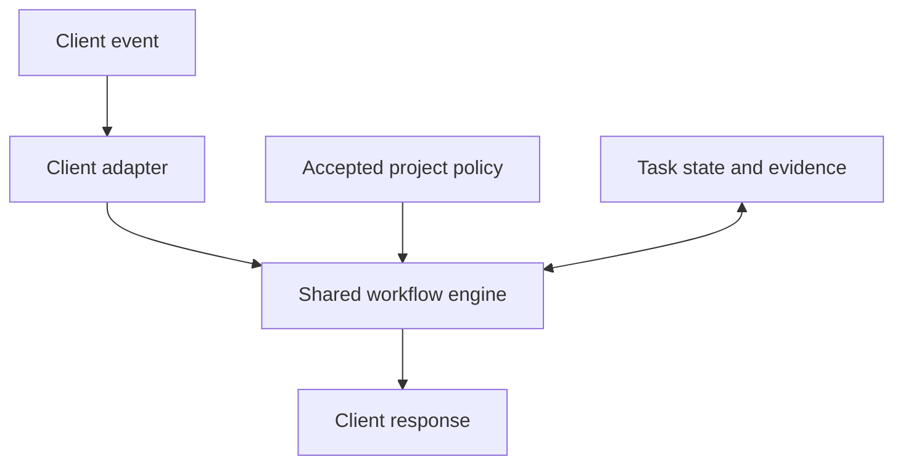

# Onboard my Project

Design and implementation plan · 25 October 2026 · **Stages, feature baseline, activation behavior and two policy contracts approved; runtime implementation proposed**

Outcome: enroll a project once, then activate its agreed workflow during ordinary coding requests. Qualify each client's actual behavior. This document plans the implementation; onboarding, hooks and merge enforcement are not implemented yet.

Approved contracts: [Delegation and Model Selection](policy-contracts.md#delegation-and-model-selection) · [Proportional Security Review](policy-contracts.md#proportional-security-review).

## 1. Authority and scope

1. **Vibe Coding Toolkit defines the workflow.** [Prompt 12][setup] governs existing-project onboarding. Follow its complete applicable procedure and current catalog, including native harness evaluation. New-project creation and machine setup retain their separate entry points.
2. **The user's decisions define project-specific choices and extensions.** Automatic workflow controls, shared coordination and required merge review are our requested extensions. The toolkit itself excludes Git hooks, branch/worktree requirements and commit/push protections from ordinary setup. Do not introduce those as toolkit requirements.
3. **Official client documentation defines adapter behavior.** An unsupported capability remains unsupported.
4. **`vibe-setup` supplies implementation lessons only.** Reuse concepts after evaluation; implement small modules against the new contracts.

Reviewed toolkit revision: `790a895304e0c08b70a5b215c9d334f1c86b816c`. Secondary reference: `vibe-setup` at `aa72e11fd05252fbedc3258813b9c6144ddb3101`; both matched `main` during research.

For every new onboarding/update run, resolve current toolkit `main` once. Read all required sources at that revision outside the project; record source paths and revision. Resume an interrupted run at its recorded revision. A trusted cached revision may support offline work with freshness explicitly unverified. Do not vendor upstream prompts into this plugin or fetch them on routine hook events. Changed upstream instructions become a reviewed update, not a silent change to an active task.

## 2. Stages and policy decisions

The user approved these three stages, the feature tables, activation behavior below and the two linked policy contracts. Other policy details and implementation choices remain proposals.

| Stage | Responsibility | Evidence |
| --- | --- | --- |
| **1. Installation** | Make the plugin's capabilities available in the selected clients | Package discovery and working required adapters, hooks, runtime and diagnostics |
| **2. Project Onboarding** | Resolve conflicts, adopt mandatory policies and configure their mechanisms for the selected project | Recorded decisions, qualified project configuration and complete toolkit coverage |
| **3. Runtime** | Evaluate adopted policies for each task and enforce their required actions | Applicability decisions and current check, review and completion evidence |

### Activation and communication

Activate the workflow only for explicitly onboarded projects; installation alone does not enroll a project. Confirm successful onboarding once. During ordinary tasks, check enrollment and load applicable policy and state silently. Do not announce routine activation or repeat unchanged policy explanations.

Briefly explain only useful task steps, blockers (including broken integration), or decisions the user needs to make. Expand explanations only as needed to resolve a blocker or support a decision. Silent activation preserves required checks, evidence and completion reporting; it does not establish that integration is healthy.

### Project Onboarding steps

The entry point is **Onboard my Project**, skill ID `onboard-my-project`; keep its entry instructions within 150 words. It calls the current upstream procedure and the plugin's small onboarding helpers.

| Step | Agent does | User sees |
| --- | --- | --- |
| Inspect | Resolve target, read instructions, classify features and adoption, identify policy conflicts, assess merge-gate feasibility and run safe baseline checks | A feature table with requirements, adoption, evidence and conflicts |
| Decide | Select an onboarding mode when conflicts exist, then resolve unknowns without waiving required features | One focused question at a time, recommendation, impact and reversibility |
| Plan | Build the full toolkit coverage matrix and exact proposed changes | Reviewable design/plan, outstanding choices and applicable authorization |
| Apply | Execute approved changes in dependency order with recovery records | Progress and specific blockers |
| Prove | Check configuration, new-session loading, actual execution and reruns | Evidence, remaining limitations and next actions |

### Installation capabilities

| Feature | Mandatory? | Installation establishes |
| --- | --- | --- |
| Plugin package and entry skills | Yes | Discovery of the workspace, onboarding and maintenance entry points |
| Client adapter and automatic hooks | Yes | Required events load and execute in each selected client; additional clients remain a separate choice |
| Workflow engine, state and diagnostics | Yes | Policy evaluation, durable progress and detection of broken integration |
| Configuration, update and recovery mechanisms | Yes | Planned changes, apply, resume and rollback |

Installation makes capabilities available. Project adoption and task compliance are established in their respective stages.

### Project policies and runtime decisions

**Mandatory policies are non-negotiable in every onboarding mode.** Adopt the policy and qualify its mechanism during Project Onboarding; evaluate its applicability during Runtime. Conditional execution never makes adoption optional. This approved feature baseline supplements the complete upstream catalog; no target project has been assessed.

| Feature / policy | Mandatory adoption? | Runtime decision or behavior | Project adoption |
| --- | --- | --- | --- |
| Project scope and policy authority | Yes | Resolve the repository, instructions, permissions and task state | Not assessed |
| Complete toolkit coverage | Yes | Use applicable adopted capabilities; onboarding assesses the full catalog, required integrations, equivalents and justified exclusions | Not assessed |
| Task scope, planning and acceptance criteria | Yes | Determine planning depth and completion criteria | Not assessed |
| Checks and completion evidence | Yes | Select relevant checks and require current results before completion | Not assessed |
| Proportional Security Review | Yes | After implementation, assess actual changes and require applicable security coverage before completion or merge | Not assessed |
| Independent and specialist review | Yes | Review requirements, behavior and regressions before every merge; determine independence and specialist involvement by risk | Not assessed |
| Delegation and Model Selection | Yes | Select execution mode, worker capability and effort; coordinate resource ownership and bounded escalation | Not assessed |
| Documentation, context and handoff | Yes | Update affected records and preserve enough context for reliable continuation | Not assessed |
| Merge readiness and enforcement | Yes | Permit a merge only after applicable checks and reviews pass for the current changes | Not assessed |
| Workflow evaluation and maintenance | Yes | Revalidate affected capabilities after relevant changes and investigate observed failures | Not assessed |
| Additional integrations outside required scope | No | Use selected integrations with their prerequisites; toolkit or accepted project requirements take precedence | Not assessed |

Proportional Security Review names the security policy. General review remains part of Independent and specialist review. Neither policy requires a separate specialist agent for every change. Stack-specific tools follow the full toolkit assessment, including its default native harness method. Capabilities and implementation choices remain distinct: durable state is required; SQLite is proposed.

### Readiness and evidence

Track three facts separately: **policy adopted and mechanism qualified**, **action applicable**, and **action satisfied**. A policy-based reason may make an action inapplicable. Missing prerequisites, unavailable reviewers or failed checks cannot provide that reason. Unknown applicability remains unresolved; it cannot count as satisfied.

Proposed feature records: `id, stage, mandatory_adoption, basis/source, execution_rule, adoption, verification, evidence_or_blocker`. Stage values are `installation`, `project_onboarding` and `runtime`. Adoption is `not_assessed`, `adopted`, `reused_equivalent`, `not_adopted` or `blocked`; verification is separate (`not_run`, `passed`, `failed`). Runtime decisions record the policy/task identity, applicability, reason, required actions and current evidence. Installed/configured alone is insufficient; existing equivalents require behavioral evidence.

**Project readiness:** apply the [mandatory-adoption rule](#project-policies-and-runtime-decisions) throughout the accepted scope. Missing adoption or mechanism qualification leaves Project Onboarding incomplete, with the blocker and remedy. Qualification proves the policy can operate; it does not require executing every possible future review or preapprove any future task. Runtime enforces triggered actions again. An unavailable required specialist blocks dependent completion or merge while independent authorized work continues. Optional omissions may remain explicit.

### Choose how to handle existing policies

After the read-only inventory finds conflicts, show a short summary and ask this early question before proposing replacements:

> How should Vibe Coding Workflow handle this project's existing workflow?

| Choice | Resolution rule | Further questions |
| --- | --- | --- |
| **1. Decide with me** | Present each logical conflict with its existing source, incoming rule and recommended resolution | Ask how to satisfy required features and resolve optional conflicts, one at a time |
| **2. Preserve my workflow** | Keep existing workflow behavior; add compatible policies and integrations; required incompatibilities block enrollment | Ask about a scoped resolution for required conflicts and unresolved choices outside the standing rule |
| **3. Replace my workflow** | Adopt the toolkit-based workflow and retire the old workflow within the reviewed migration scope; archive superseded content | Ask about ambiguous ownership, scope or exceptions; do not re-ask every covered replacement |

The user proposed these three modes. Recommend choice 1 when they want guidance, but never select it on their behalf. If there are no conflicts, proceed with the applicable onboarding decisions without this extra question; do not infer a future replacement preference from that absence.

Record `onboarding_mode`, repository/client scope and the decision reference in project policy. Reuse the preference on reruns within its scope. A mode controls conflict resolution; authorization to apply changes remains tied to the reviewed plan. No answer in a noninteractive run means pending, not implied replacement permission.

In preserve mode, reuse compliant existing mechanisms. Present incompatible policies with a scoped resolution; retaining one leaves the required feature `blocked` under the [readiness rules](#readiness-and-evidence). Do not silently overwrite the user's workflow. Record optional conflicts as `not_adopted`, reason `deferred_by_user_policy`. Report actual adoption and enforcement separately.

**Proposed replacement boundary, awaiting refinement:** replace the selected project's AI workflow instructions, hooks and agent configuration; retain product requirements, application code, architecture constraints, credentials and unrelated tooling. Shared/global integrations require separate scope decisions. The mode does not override host or organization controls, or authorize new costs and production changes.

“Replace” means the entire legacy workflow layer within that scope, including compatible old process rules, rather than only conflicting rules. Working tools may be reused under the new policy. List preservation exceptions in the migration preview so the resulting workflow has one clear authority.

Archive whole files only when they contain exclusively superseded workflow material. For mixed files, back up the original and replace only reviewed sections. Keep backups outside the repository and client instruction/skill discovery paths; record original locations, hashes and restoration steps. Retire obsolete hook registrations as well as their files, then verify behavior in a new session. Rollback preserves subsequent user edits through the existing conflict checks.

The agent identifies semantic conflicts with source evidence; scripts validate and apply selected resolutions. Do not claim a deterministic scanner can discover every policy contradiction. Treat uncertain compatibility as pending assessment rather than a proven safe addition.

### Questions within the selected mode

Detect facts; reuse explicit prior decisions and the selected mode; ask when an unresolved choice changes scope, behavior, cost, access, architecture or enforcement. A recommendation is never recorded as the user's choice. Minor reversible implementation details may use stated assumptions, following upstream. Preserve existing authorization rather than repeatedly requesting it. Pending decisions block only dependent work.

Examples:

- “These two instruction files disagree about the test command. Which should be canonical?”
- “Which installed clients should this project support?” Only ask if the selection is not already established.
- “The required merge gate needs a trusted review source. Which existing integration should satisfy it?” If none qualifies, report incomplete enrollment and continue independent authorized work.

Record each material decision as `id, scope, options, selected_value, provenance, status, affected_actions, invalidation_trigger`. Provenance distinguishes user confirmation, existing project rules, observed facts and assumptions. Status is `confirmed`, `inherited`, `proposed` or `pending`. Store the evidence/reference behind inherited choices. The enrollment journal also binds approvals to a design/plan digest, scope and user-message reference. Material revisions reopen only affected decisions and approvals.

Use the host's question UI when available and ordinary conversation otherwise. Hook subprocesses never attempt an interactive questionnaire. In a noninteractive run, return the pending question and continue independent authorized work.

## 3. Architecture



**Proposed runtime:** Python 3.11+ and its standard library, including SQLite for local coordination. Detect the interpreter; a missing runtime becomes a workspace prerequisite. Keep code in the installed plugin. Project repositories receive policy and necessary documentation/configuration, without duplicated runtime scripts.

| Component | Responsibility |
| --- | --- |
| `runtime/adapters/codex.py` | Probe the actual client surface/version; normalize Codex events; render supported responses |
| `runtime/adapters/claude_code.py` | Later, provide the same contract through Claude's native mechanisms |
| `runtime/engine.py` | Evaluate accepted policy and task state; return decisions without host-specific JSON |
| `runtime/state.py` | Short transactions, event deduplication, task identity and resource ownership |
| `runtime/onboarding.py` | Inventory, source revision, decision records and coverage plan |
| `runtime/changes.py` | Planned edits, fingerprints, backups, apply/resume/rollback |
| `runtime/evidence.py` | Check/review provenance, freshness and completion requirements |
| `scripts/workflow.py` | One command entry point for hooks, diagnosis and enrollment operations |

Add modules only with their deliverable. Avoid an SDK, daemon, dashboard or separate orchestration service at this stage.

### Adapter contract

```text
probe(target)                 -> capabilities + observations
normalize(native_event)        -> Event | UnsupportedEvent | InvalidEvent
evaluate(event, policy, state) -> pass | deny | context | pending_decision
render(result, native_event)   -> stdout JSON + exit status
plan_config(existing)          -> owned edits + conflicts + validation
```

`Event` contains a schema version, client/surface/version, native event and call IDs, session/actor identity, resolved repository/worktree, operation and observable settings. Missing data stays unknown. Internal `pending_decision` is never blindly serialized as a client hook response. `pass` preserves the client's existing permissions; it does not grant additional access.

Capabilities distinguish `documented`, `configured`, `trusted`, `observed` and `unsupported`. Qualification is bound to client version, surface, adapter/runtime digest and relevant configuration. A successful mock is not observed client execution.

`doctor` runs independently of the hooks it diagnoses. Missing, disabled or untrusted hooks and changed qualification inputs invalidate current protection claims; old observations remain history. Where current trust or execution cannot be observed, report unverified.

### Persistence

| Location | Contents |
| --- | --- |
| `.vibe-coding-workflow/project.json` | Versioned project ID, schema version, accepted feature requirements/adoption and policy, onboarding mode/scope, source revision, selected clients and canonical-document mappings |
| Existing canonical project docs | Toolkit setup record, decisions that affect architecture, quality commands and maintenance; reuse upstream's nine-destination map |
| One machine-local data directory | Enrollment journals, private backups, capability evidence and SQLite task/ownership state; shared by qualified clients |

The shared data directory is selected during enrollment and stays outside Git and plugin installation caches. Do not assume two vendors' `PLUGIN_DATA` directories share state. Exclude secrets and raw transcripts from routine records. Use SQLite only on a supported local filesystem.

Identity is `(project_id, local checkout/common Git directory, worktree, session, task_id)`. Resolve nested directories, linked worktrees and separate clones explicitly. A parent directory containing several repositories does not authorize enrolling all children. Register cross-repository membership only when selected.

Bind active tasks to policy, source and runtime versions. Defer incompatible enrollment/runtime/state-schema updates until affected writers are confirmed stopped; then reconcile pending tasks and evidence. Never silently switch an active task's rules. Other clients using shared state must pass schema/version compatibility checks.

## 4. Hooks and enforcement

| Native event | Intended behavior | Limit |
| --- | --- | --- |
| `SessionStart` | Resolve enrollment; inject a short policy pointer and outstanding state | Unenrolled repositories receive no workflow changes |
| `PreToolUse` | Check supported guarded actions, approved task scope and resource claims | Unknown tool paths are not advertised as protected |
| `PostToolUse` | Record observable results and mark affected evidence stale | A completed action cannot be undone by this hook |
| `SubagentStart` / `SubagentStop` | Correlate workers and observed lifecycle | A start event alone is too late to prevent dispatch |
| `Stop` | Check explicit task completion state; request a bounded continuation when useful | Never loop on unanswered questions, cancellation or external blockers |

Use host-specific hook files, such as `hooks/codex.json` and later `hooks/claude-code.json`, with explicit manifest references. Inspect existing interceptors and preserve RTK or other working integrations. Register each handler once.

Runtime rules:

- Validate a top-level JSON object and event-specific fields; bound input size and execution time. Serialize only supported responses.
- Keep the fast path local: no upstream fetch, model call, full test suite or expensive rescan per event. Inject context on relevant transitions; unchanged events normally emit nothing.
- Orientation failures produce a short diagnostic. Failure of a required check prevents a success/ready verdict. A live guard denies an affected action only through a mechanism proven to block in that client; timeout or missing-hook behavior must be measured separately.
- Keep transactions brief. No model, network or long-running process executes while holding a state lock.
- Track native call IDs where available. Handle duplicate and out-of-order events without double-applying state changes; use idempotent transitions when the host supplies no unique event ID.
- Default to at most one automatic continuation for the same unresolved stop condition. Respect smaller user limits and explicit pauses. Ending with `blocked` or `awaiting_user` remains valid.

**Verified platform constraints:** Codex requires trust of the current plugin hook definition. Its current `PreToolUse` does not support `permissionDecision: "ask"`; that response can fail the hook and allow the tool to continue. Cloud-orchestrated ChatGPT Work does not support plugin hooks. Qualify local Codex first, and show unsupported surfaces honestly. Claude has different output and registration semantics. [Client sources: 4–7 below.]

### Evidence, general review and Proportional Security Review

Task states: `planned`, `active`, `awaiting_user`, `blocked`, `verifying`, `ready`, `cancelled`. Within the runtime API, only the verifier can transition to `ready`; an agent's success message is insufficient. Accept independent review provenance from a correlated reviewer execution observed by a qualified adapter, or a trusted external integration. A report's own claimed identity cannot establish provenance. Local records protect workflow integrity; they are not a security boundary against processes with the same filesystem permissions. Repository enforcement has a separate trust boundary below.

Bind results to the candidate content, base revision, relevant check definitions, policy digest and reviewer/executor provenance. Account for staged, unstaged and relevant untracked content; HEAD alone is insufficient. A change to those inputs invalidates affected evidence. Recheck actual content before completion because a missing hook must not preserve stale success.

General review covers requirements, behavior and regressions before every merge. The approved [Proportional Security Review contract](policy-contracts.md#proportional-security-review) defines its timing, scope and blockers. Proposed escalation guide for the remaining general-review policy, to refine during Project Onboarding:

| Change | Required coverage |
| --- | --- |
| Bounded, low-risk | Focused requirement/diff review and applicable deterministic checks |
| Nontrivial behavior | Independent behavior/regression review plus affected checks |
| Security, data, migrations, concurrency or uncertain scope | Appropriate specialist review and stronger evidence |

Resolve uncertain risk or obtain appropriate review before accepting dependent completion. Use the complete diff and project rules, not a file-extension shortcut. An inapplicable specialist action needs a policy-based reason; an unavailable required reviewer blocks dependent completion or merge.

Worker routing follows the approved [Delegation and Model Selection contract](policy-contracts.md#delegation-and-model-selection). Cross-vendor execution is a later integration, not an assumed feature of a hook adapter.

### Ownership and merge assurance

Managed workers claim canonical writable files and mutable resources transactionally before dispatch. Include ancestor/path aliases and shared ports/build directories. Reviewers receive read-only scope. Call it enforced only when a qualified sandbox/tool restriction prevents an attempted write; otherwise record it as a workflow convention. The coordinator owns lockfiles, shared configuration and Git operations. An uncertain worker retains ownership until confirmed stopped; elapsed time alone does not release it. Uncontrolled external writers remain a capability limitation.

Client hooks provide workflow guardrails. **Enforcement of every merge needs a repository-controlled gate.** When selected and available, a GitHub adapter must require the final verifier on the actual current candidate/base, handle merge queues when used, and verify the applicable rules and bypass settings.

The verifier must run from a trusted definition and obtain authoritative check/review results. A PR-writable JSON report or a local `review_passed` flag is not proof. Reuse a qualified existing review integration first. If no trusted review source works under the selected subscriptions, required repository review enforcement remains blocked and enrollment stays incomplete for that scope; do not introduce API billing or manufacture a passing result. Repository rules and trusted execution are an explicit deliverable, not a promise supplied by installing client hooks. [GitHub sources: 8–9 below.]

## 5. Small deliverables

Each deliverable receives its own reviewable change and evidence. Unit/fixture validation and actual client qualification are reported separately. A missing target client does not prevent implementing independent slices.

| ID | Deliverable | Concrete output | Acceptance |
| --- | --- | --- | --- |
| **D1** | Codex adapter and startup hook | Event contract, root resolver, `codex.py`, `hooks/codex.json`, dispatcher and manifest wiring | Nested/worktree fixtures resolve correctly; unrelated repo is untouched; a real installed/trusted hook loads the policy once |
| **D2** | Deterministic hook runtime | Local state, guarded-action responses, post-tool invalidation, bounded Stop handling and `doctor` | Actual denial blocks; pass preserves native permissions; missing/untrusted/disabled hooks, crash and timeout produce honest health; pending decisions cause no continuation loop or implicit permission grant |
| **D3** | Guided onboarding plan | `onboard-my-project` skill, source resolver, feature/adoption table, conflict inventory, mode and decision record | Three stages distinguished; full catalog covered; mandatory policies separated from conditional actions; no mode waives a policy; equivalents require evidence; merge feasibility established |
| **D4** | Reversible Project Onboarding and toolkit adoption | Transaction module, approved component execution, mode-aware configuration/docs, inactive backups, `apply`, `resume`, `rollback` | Missing mandatory policy/mechanism qualification prevents readiness; future task evidence remains separate; required conflicts resolve or block; recovery preserves unrelated content |
| **D5** | Checks, general review and security review evidence | Approved security contract, remaining risk policies, applicability decisions, check runner and completion verifier | Security review runs after implementation with no planning-time review gate; every merge receives general and applicable security coverage; missing/stale required evidence or blocking findings prevent readiness |
| **D6** | Worker routing and concurrent ownership | Approved delegation contract, model/effort evidence, bounded dispatch, atomic reservations and stop reconciliation | Fifteen concurrent claims cannot acquire overlapping resources; limits/approved fallbacks hold; unsupported selection is explicit; uncertain ownership survives; reviewer restrictions and policy updates are tested |
| **D7** | Repository merge gate | Trusted evidence integration, disposable enforcement qualification and exact ruleset plan, delivered separately below | Missing/stale review or failed checks prevent merge through supported UI/API/CLI paths; absent trust/access remains blocked |
| **D8** | Claude Code adapter | Native manifest/config adapter and shared contract fixtures | The same scenarios pass in an actual Claude session; no duplicate handlers or policy fork; settings evidence remains truthful |
| **D9** | PHIOON pilot | One Python and one Next.js repository, then one bounded cross-repository task | Ordinary requests activate workflow without skill mentions; shared-resource coordination and relevant upstream harness cases pass; overhead is measured |

Sequence: **D1 → D2 → D3 → D4**, then **D5 → D6 → D7**. D8 can follow D4 independently; D9 follows the capabilities selected for the pilot. D7 includes a distinct review of the concrete repository settings before any live changes. Multi-repository rollout follows the pilot, not automatic enrollment of all nine repositories.

Keep the larger items reviewable:

- **D3a:** mandatory policy adoption, separate runtime applicability, conflict inventory and mode selection. **D3b:** complete the plan under the selected mode. Validate required and optional conflicts, a verified equivalent, a missing prerequisite, a duplicate integration, a mixed instruction file and a shared policy. Mode 1 asks how to satisfy requirements, mode 2 preserves compatible behavior and blocks required conflicts, and mode 3 proposes scoped replacement. Every mode rejects missing mandatory policies as ready; a task's inapplicable specialist action does not disable its policy.
- **D4a:** transaction engine and disposable recovery tests. **D4b:** execute approved toolkit adoption through upstream procedures, one dependency group at a time. Include applicable installations/updates/reuse, quality work, integration checks and initial native harness evaluation. A configuration-only result cannot mark adoption complete. Blocked components retain their exact resumption condition; do not build a parallel catalog of custom installers.
- **D7a:** trusted evidence source and final-verifier contract. **D7b:** disposable-repository enforcement, including stale base, altered candidate, failed/cancelled/skipped evidence and applicable merge-queue cases. **D7c:** review and apply the exact live ruleset changes under the user's authorization. A verifier job must explicitly succeed after checking its prerequisites; upstream jobs being skipped must not manufacture success.
- **D9:** include relevant instruction-discovery, partial-blocker, stale-handoff, stop/resume and unchanged-rerun cases from the toolkit, alongside the project checks.

### First implementation slice: D1

Add only the dispatcher, Codex normalization/response module, root resolution, startup handler, fixtures and manifest reference. Use a disposable enrolled-project fixture. Extend the existing package validator to check hook paths. Keep enforcement handlers for D2.

Run package validation, fixture checks, `git diff --check`, then a real new-session startup probe on the target client. Record client surface/version and hook trust. If that client is unavailable here, report the live probe as not run. Do not change PHIOON as part of D1.

Check the [approved activation behavior](#activation-and-communication) in enrolled, unenrolled and broken-integration scenarios, distinguishing internal context loading from user-facing messages.

### Project Onboarding transaction rules for D4

Bind the apply plan to target identity, source/policy revision and before-file hashes. Back up changed owned content; write each file atomically and journal progress. Filesystem edits are not a single atomic transaction: recovery reconciles each applied operation. Resume from verified state. Rollback restores only content still matching the plugin's recorded output; concurrent user edits become explicit conflicts. Privileged/external changes remain separate operations with their own authorization and recovery.

## 6. Improvements to measure

| Reference lesson | Proposed improvement | Evidence |
| --- | --- | --- |
| Hooks copied into each project | One installed runtime and small per-project policy | Update touches runtime once; project customizations survive |
| Large instructions injected into workers | Short transition-specific context and on-demand references | Captured hook output size and observed tokens where available |
| Briefs declare writable files | Atomic ownership before managed dispatch | Concurrent conflict tests |
| Native logs treated as qualification | Capability-specific provenance and honest unknowns | Contradictory/missing settings fixtures plus client probes |
| Independent installation/update write paths | One recovery-aware change module | Interrupted apply/resume/rollback cases |

Proposed performance targets, to validate on the target machine: routine local hook p95 below 100 ms, context output within 150 words, and zero network/model calls in the hook fast path. Record end-to-end task latency, introduced regressions, review findings, retries and observed usage. Do not claim token savings from output length alone.

Upstream's native harness method supplies the evaluation procedure: run relevant baseline cases, change one demonstrated weakness, compare a bounded disposable candidate and preserve working behavior. Do not automatically start paid benchmark runs.

## Sources

1. [Toolkit existing-project setup, Prompt 12][setup] — primary onboarding contract.
2. [Toolkit hooks guidance][toolkit-hooks] and [shared instructions][toolkit-agents].
3. [Toolkit native harness improvement, Prompt 15][harness].
4. [Codex hook events, responses and trust](https://learn.chatgpt.com/docs/hooks).
5. [OpenAI plugin packaging](https://developers.openai.com/plugins/build/plugins).
6. [ChatGPT/Codex plugin surface support](https://learn.chatgpt.com/docs/plugins).
7. [Claude Code hooks](https://code.claude.com/docs/en/hooks).
8. [GitHub rulesets](https://docs.github.com/en/repositories/configuring-branches-and-merges-in-your-repository/managing-rulesets/available-rules-for-rulesets).
9. [GitHub required-check behavior](https://docs.github.com/en/pull-requests/how-tos/merge-and-close-pull-requests/troubleshooting-required-status-checks).
10. Secondary reference: [`vibe-setup` workflow transactions][reference-workflow], [subagent hooks][reference-hooks] and [native qualification][reference-native].
11. [Instruction authoring standard](../AGENTS.md#instruction-authoring).

[setup]: https://github.com/soumatheusgomes/vibe-coding-toolkit/blob/790a895304e0c08b70a5b215c9d334f1c86b816c/docs/prompts/12-existing-project-setup.md
[toolkit-hooks]: https://github.com/soumatheusgomes/vibe-coding-toolkit/blob/790a895304e0c08b70a5b215c9d334f1c86b816c/docs/tools/10-hooks-best-practices.md
[toolkit-agents]: https://github.com/soumatheusgomes/vibe-coding-toolkit/blob/790a895304e0c08b70a5b215c9d334f1c86b816c/templates/AGENTS.md.template
[harness]: https://github.com/soumatheusgomes/vibe-coding-toolkit/blob/790a895304e0c08b70a5b215c9d334f1c86b816c/docs/prompts/15-harness-improvement.md
[reference-workflow]: https://github.com/fcoouto/vibe-setup/blob/aa72e11fd05252fbedc3258813b9c6144ddb3101/skills/vibe-setup/workflow.py
[reference-hooks]: https://github.com/fcoouto/vibe-setup/blob/aa72e11fd05252fbedc3258813b9c6144ddb3101/.codex/hooks/subagents.py
[reference-native]: https://github.com/fcoouto/vibe-setup/blob/aa72e11fd05252fbedc3258813b9c6144ddb3101/skills/vibe-setup/native_qualification.py
