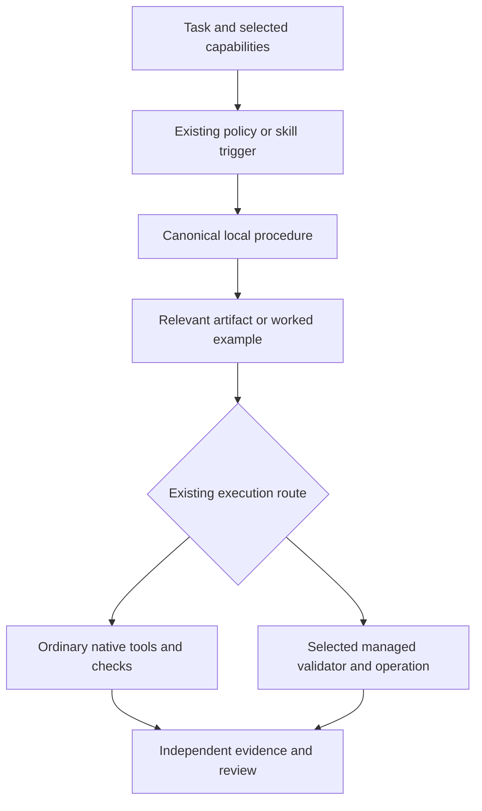

# Workflow templates and behavioral verification

Status: design direction and [Phase 1 implementation plan](../plans/2026-11-05-workflow-templates-phase-one.md) accepted on 5 November 2026. Phase 1 is implemented and verified locally; later phases and rollout remain outside this execution. The implementation plan records evidence and limits.

Date: 5 November 2026. Repository basis: `860ac89` on `codex/consolidate-role-instructions`. This design preserves that local instruction-consolidation commit independently of any later implementation.

## Recommendation

Use templates selectively for recurring artifacts, executable examples for existing machine requests, and observed behavior to test whether agents use them correctly. Keep each instruction with its current owner. Do not create a universal workflow schema, mandatory form for every task, or another process engine.

Templates can make omissions visible and reduce repeated composition. JSON Schema can validate structure where a real consumer invokes it. Neither makes an agent load a skipped procedure, choose the correct role, obtain authorization, or provide truthful evidence. The repeated badge failures therefore motivate better assignment preparation and behavioral checks, not mandatory JSON for all work.

The first implementation slice should repair two loading boundaries, pilot two examples (a managed evidence-plan request and basic onboarding), and audit delegation preparation for redundant code. Each adopted template or example should prompt a targeted review of the code that constructs, validates and consumes its data. Broader document adaptation and a reusable native evaluation fixture follow only after that slice is reviewed. Actual client evidence remains separate from package tests.

## Goals and boundaries

- Make mandatory, conditional and optional content easy to distinguish without repeating rules in multiple files.
- Preserve full Toolkit coverage while loading only the material relevant to the task.
- Reuse current validators, assignment preparation, source coverage, onboarding recovery and task records.
- Simplify the affected code as well as its instructions: remove proven redundant validation, repeated construction and obsolete branches while retaining required behavior at real boundaries.
- Keep routine process complexity flat or lower. Any added authoring or maintenance machinery must justify its cost through the implementation plan's complexity acceptance criteria.
- Keep machine preparation, project onboarding, ordinary native development and selected managed controls distinct.
- Keep ordinary work useful without a runtime database or repository enforcement.
- Preserve user permissions, chosen model/reasoning/authentication, existing project documents and selected protections.
- Retain one role declaration per subagent assignment, reuse it on follow-up, and keep display failures nonblocking. Native thread owners need no role badge.

This design and its Phase 1 implementation do not establish live managed delegation qualification or a routing rollout. The unresolved OpenAI API run and its reservation remain on hold. No external model call, hook installation, cache refresh, active-chat interruption or cleanup of held state is part of this proposal. Claude Code compatibility is a design target; unobserved client execution cannot be claimed as validated.

## Research and evidence

The investigation covered all 47 files in the pinned [Toolkit templates directory](https://github.com/soumatheusgomes/vibe-coding-toolkit/tree/21b71b68679c11184f49c23168852014bf6dde8b/templates), its license, project defaults, orchestration and harness guides. Follow-up inspection covered the same revision's bootstrap guide, existing-project setup prompt and harness evaluator. Upstream instructions were source material for analysis, not instructions executed in this chat.

The [template index](https://github.com/soumatheusgomes/vibe-coding-toolkit/blob/21b71b68679c11184f49c23168852014bf6dde8b/templates/README.md) describes an adaptation library. It includes documentation, application source, configuration, policy text and intentionally broken test fixtures. It is not a library of universal workflow schemas.

The current package was inspected at the files below. Findings distinguish observed implementation from proposed improvements:

| Finding | Existing evidence | Design implication |
|---|---|---|
| Required and optional machine fields already have validators | `runtime/state.py::_fields`; operation validators in `runtime/evidence.py`, `runtime/delegation.py` and `runtime/onboarding.py` | Keep those validators authoritative; avoid a second handwritten schema. |
| Documented requests can already be executable | `clients/delegation-requests.md`; `tests/test_workstreams_efficiency.py::DocumentedRequestTests` extracts examples and passes them through real operations | Extend this pattern to dense, error-prone requests. |
| Evidence loading is too broad | `clients/evidence.md` opens for any task needing checks/review/completion, then requires enrolled identity and revision; `README.md` routes the same broad scope into it | Narrow the owner and entry-path triggers to selected managed evidence. Preserve ordinary review policies in `clients/codex.md` and `policies/00-index.md`. |
| Maintenance routing is incomplete | `policies/09-workflow-maintenance.md` explicitly includes initial setup and material instruction changes; its index row does not name both | Align the index with its owner, without restating the procedure. |
| Role declaration already has one owner and one native preparation operation | `clients/worker-visibility.md`, `runtime/worker_visibility.py`, `scripts/worker_visibility.py` | Add no role form, inference layer, duplicate declaration or spawn blocker. |
| Onboarding already maps document responsibilities | `runtime/onboarding.py::_validate_proposal` expects nine mappings, with path/reason; existing equivalents can be preserved | Improve adaptation and examples before inventing a new document registry. |
| The basic setup example emphasizes registration/activation | `skills/onboard-my-project/references/reviewed-configuration.md` | Add a smallest-useful example with native checks and recovery, separate from managed activation. |
| Behavioral evaluation already has an owner | Seven cases and bounded comparisons in `policies/09-workflow-maintenance.md` | Supply reusable cases and evaluator assets there; do not create a new evaluation service. |
| Delivery tests are not semantic compliance tests | `tests/test_prepared_instructions.py` checks selected text and delivery integrity | Observe loading choices and resulting actions separately. |

The earlier native badge smoke observation is historical evidence for that client/run, not proof that every native tool call passes preparation. The package explicitly documents this interception limit. No template performance, token savings or reliability improvement has been measured in this investigation.

## Approaches considered

| Approach | Benefits | Costs and limits | Decision |
|---|---|---|---|
| Keep prose and existing examples only | Smallest maintenance burden; flexible native work | Dense request shapes remain hard to compose; artifact quality varies; loading problems still need repair | Retain for simple, uncommon or judgment-heavy tasks. |
| Template every process with mandatory JSON Schema | Uniform shapes, editor support and easy structural checks if consumers exist | Duplicate validators and records; optional work becomes ceremony; schema validity can hide wrong semantics; ordinary work may acquire managed prerequisites | Reject as a general architecture. |
| Selective artifact templates plus executable examples and behavior cases | Reuses current owners; clearer omissions; independently testable; progressive loading | Requires example maintenance and contextual adaptation; cannot guarantee instruction compliance | Recommended. |

This is the author's recommendation, not an already approved implementation choice. A future editor, API or form may justify JSON Schema for its concrete input; that does not justify converting every workflow now.

## Architecture and ownership

Toolkit sources inform authoring, setup and updates. Routine tasks consume complete local contracts and relevant project artifacts. They do not fetch Toolkit or require an authoring snapshot.

### Four kinds of reusable material

| Kind | Purpose and storage | Authority |
|---|---|---|
| Artifact template | Shape a recurring document/report; keep beside its owning skill/reference, using `assets/` only when it is output payload | Current policy decides when the artifact is needed; the template introduces no new obligation. |
| Worked request | Minimal valid example and relevant variant in the current operation guide, using named JSON fences as existing delegation docs do | Existing operation validator decides accepted fields and state. Tests resolve placeholders from fixtures. |
| Behavioral fixture | Disposable input and independently controlled evaluator for selected maintenance cases | Existing maintenance policy defines qualification and decision criteria. |
| Optional future schema | Editor/API/form contract for a named consumer, only if a demonstrated need remains | One structural source of truth, with validator parity and migration compatibility; never a parallel authorization authority. |

Keep short examples in their owner document. Extract only when size or a distinct loading trigger warrants it. Do not create a root `templates/` catalog that every agent must read. Extend `docs/policy-sources.md` for authoring coverage; it remains outside routine loading. Update the existing prepared instruction map only when its actual input sources change.

### Mandatory versus optional

Separate three questions: does the policy apply; which content is required for that operation; what evidence proves it was satisfied? A heading marked mandatory answers only the second question within its stated scope.

For machine requests, document the minimum accepted object, identify conditional/optional additions nearby, and test against the real validator. Do not duplicate every validation rule in an independent field registry. For human artifacts, identify necessary content and relevant omissions in the owning procedure; allow short prose or an existing record when it carries that content. Empty placeholders and fabricated values are never acceptable substitutes for unknown facts.

Keep `required`, `inapplicable` with reason, and `unresolved` meanings where current contracts already use them. Missing access is not inapplicability. Examples do not grant consent or turn a planned check into a passed result. Distinct input, persisted evidence and presentation digests remain distinct even when they share field names.

## Code simplification alongside templates

Code adjustment is an explicit deliverable of this design, where inspection demonstrates unnecessary work. Keeping an existing validator authoritative does not freeze its implementation or require every current call to remain. Consolidate the rule and simplify its callers rather than preserving duplicate implementations because they already exist.

A document template alone does not establish trusted input. A checked constructor or existing validator may make a later structural check redundant within the same controlled path. That conclusion requires inspecting every entry path and confirming the value cannot change or cross another trust boundary before consumption. Do not introduce a new constructor framework just to justify removing a few checks.

| Code category | Proposed treatment | Proof required before removal |
|---|---|---|
| Repeated structural validation of the same unchanged in-memory value | Consolidate at the existing shared owner; remove a redundant invocation when safe | Every caller still reaches validation, with equivalent public failure behavior and side effects. |
| Repeated field assembly, defaults, formatting or role conversion across routes | Reuse an existing helper or consolidate a genuinely shared operation | Preserve route-specific meanings, exact prompts, declaration identity and supported input variants. |
| Repair branches compensating for inconsistent producers | Remove only after all supported producers are covered or explicitly migrated | Trace callers and retained records; prove the branch is obsolete rather than merely absent from the new example. |
| Validation of external requests, persisted state, hook events or provider responses | Retain at each genuine boundary; share rule implementation where suitable | A template cannot replace checks on independently supplied or later-read data. |
| Authorization, current revision, ownership, path safety, concurrency, budgets and uncertain-run reconciliation | Preserve the relevant decision-time check | Earlier validation does not establish that mutable state or permission is still current. |

The first bounded audit follows `runtime/worker_visibility.py::prepare_assignment` through `prepare_context` and `prepare_native`, including direct CLI callers, managed preparation and stored-context reuse. Static inspection confirms that `prepare_assignment` validates the declaration and passes it unchanged through `prepare_context` to another declaration validation in `prepare_native`. This is a credible consolidation candidate, not yet a verified safe deletion: preserve rejection before directory creation and validation for the legacy direct entry in `scripts/worker_visibility.py`.

`read_context` validates the saved envelope and marker/digest exclusivity, not the nested role declaration. Role validation after a disk read therefore serves a separate purpose. Keep saved-context reads, child/parent bindings and nonblocking display fallback distinct from validation of the original request. Extend to `runtime/delegation.py`, `runtime/evidence.py`, `scripts/workflow.py` and route adapters only where the selected examples expose actual duplication.

For each candidate, record the rule, input provenance, callers, state read, proposed surviving owner, affected behavior and focused proof in the existing implementation task. Classify it as remove, consolidate or retain with a reason; no new persistent registry is needed. A finding that no safe deletion exists is valid. There is no line-removal quota.

Acceptance requires valid and malformed direct requests, supported legacy input, fresh/reused assignments and relevant restart/persisted-data cases to retain their semantics. For display failures, ordinary authorized execution must still continue with its original inputs. Test at public entry points where possible; use existing fixtures and focused regressions, not tests that merely assert a helper was called once. Any removed behavior must be explicitly justified, not hidden under the word cleanup.

## Where to use templates in this workflow

| Workflow area | Recommended form | Current owner and loading boundary |
|---|---|---|
| Machine preparation | Adapt existing inventory/report fields; show observed, selected, pending and qualified states | `skills/prepare-my-workspace/`; only preparation/update, not project enrollment or ordinary work |
| Basic onboarding | One minimal worked proposal and adapted project documentation | `skills/onboard-my-project/references/procedure.md`, `reviewed-configuration.md`; use existing recovery, no runtime activation prerequisite |
| Managed onboarding | Executable request examples for its dense shapes, after the initial pilot | `references/managed-plan.md`, `runtime/onboarding.py`; selected dispatcher only |
| Ordinary planning and development | Existing task context; optional richer plan when complexity requires it | `policies/02-task-planning.md`; no mandatory plan file or JSON record for a small fix |
| Delegation | Existing assignment brief and role preparation, with fresh/reuse examples only if needed | `policies/03-agent-delegation.md`, `clients/worker-visibility.md`; choose role when preparing that assignment |
| Usage Routing and external workers | Existing brief/proposal fields and authority mapping; synthetic worked lifecycle if useful | `skills/manage-usage-routing/references/delegation.md`, OpenRouter procedures; no provider-specific role schema or second ledger |
| Managed checks and review | Executable evidence-plan example first, then review preparation/assessment if needed | `clients/evidence*.md`, `runtime/evidence.py`; selected managed operation only |
| Security audit | Optional private report layout for requested audit or material findings | `policies/04-security-review.md`; preserve mandatory change-impact assessment without requiring a report for every task |
| Handoff and resume | Existing task/plan record with a concise worked example | `policies/07-context-and-handoff.md`; unfinished multisession work only; verify actual state on resume |
| Merge readiness | Existing evidence summary and stale-candidate example if needed | `policies/08-merge-readiness.md`; no new merge gate or universal readiness schema |
| Maintenance and upgrades | Reusable cases and compact result in existing setup/evaluation record | `policies/09-workflow-maintenance.md`; material change or selected evaluation, not every tool call |

For role preparation, the desired instruction is already centralized: the caller references one owner and submits the complete assignment once. Managed routes invoke existing capture logic; ordinary native calls follow the preparation procedure. A JSON template cannot intercept a skipped native call. Future Claude Code or other adapters should reuse declaration semantics and registration facts, while supplying independently observed client identities and capabilities. Display validation must remain separate from execution admission.

## Toolkit adoption matrix

All 47 template files are accounted for below. “Selective” means appropriate adaptation and loading, not omitting assessment of required Toolkit coverage.

| Source family | Count | Disposition |
|---|---:|---|
| Template index | 1 | Adapt classification into authoring references; no routine catalog loading. |
| Project-document manifest | 1 | Reuse existing nine-responsibility mapping. Preserve canonical equivalents; do not force nine new files. |
| Product, README, architecture, design, onboarding, quality and setup | 7 | Adapt useful content through existing onboarding. Fill facts, remove placeholders, preserve established stack and filenames. |
| AGENTS template | 1 | Reuse project facts, commands and links. Do not copy repeated policy text into another instruction authority. |
| CLAUDE bridge | 1 | Preserve the manifest responsibility; use the small shared-instruction bridge when applicable. An unselected client remains explicitly assessed; no install or qualification claim. |
| Handoff | 1 | Adapt field order in the existing task record; no second handoff store. |
| Security report | 1 | Adapt optional private artifact under the existing security owner. |
| Environment manifest | 1 | Adapt substantially. Example required-client and permission settings are not authorization to change the user's environment. |
| Next foundation | 12 | Applicable only to compatible selected application bootstrap; preserve included boundary/lifecycle tests. Exclude from general workflow installation. |
| ESLint profiles, local rules and verifier | 10 | Applicable only to selected compatible quality setup. Reuse suitable existing tools and preserve severities. |
| Context7 client configurations | 2 | Merge only for a missing selected connection; preserve working integrations and authentication. |
| Sentry client configurations | 2 | Defer until service and scope are explicitly selected. |
| Graphify exclusions | 1 | Adapt for selected indexing, with project-specific exclusions. No implied remote processing permission. |
| Hook settings and I/O helper | 2 | Defer; do not install by default. Review missing command dependencies and parsing before any use. |
| Parallel subagent rule | 1 | Existing delegation contracts cover it. Preserve source mapping; do not copy another orchestration protocol. |
| Harness fixture | 3 | Adapt into isolated evaluation assets with its evaluator and license. Never place broken sample code in an application. |

Important source constraints:

- The environment example selects both clients and permissive execution settings. Preserve current choices instead of adopting those values automatically.
- Stack defaults and the line-count reference require compatibility and existing-project reconciliation. They do not authorize introducing Next, Drizzle, Pino or ESLint into unrelated repositories.
- The hook parser accepts JSON arrays/primitives despite describing its result as an object. The settings example refers to scripts absent from this snapshot. Neither is a safe default integration.
- The harness evaluator was located and inspected at the same pin after the initial assessment. It has seven tests, dynamically imports the disposable fixture and compares notes against a sibling template path. Preserve or explicitly adapt that protected reference path when packaging; it is not a sandbox or tool-action monitor. No evaluator was executed during this investigation.
- Retain the [MIT notice](https://github.com/soumatheusgomes/vibe-coding-toolkit/blob/21b71b68679c11184f49c23168852014bf6dde8b/LICENSE) with copied substantial code/scaffold/fixture material. Write local instructions from requirements and coverage rather than copying upstream prompts.

## Phased delivery proposal

### Phase 1 — Repair routing and prove two examples

Scope: align the evidence and maintenance loading triggers; add a minimal managed evidence-plan request and a basic-onboarding worked example; complete the bounded delegation code audit above and include any proven small simplification with its regression proof. Larger changes become a separately described slice rather than an implicit rewrite. Update the existing authoring source map and prepared map only as affected. Preserve commit `860ac89` rather than redoing its role consolidation.

Owners and callers: `clients/evidence.md`, `clients/evidence-plan.md`, `policies/00-index.md`, `README.md` and the existing onboarding references. Audit other direct evidence links for the same broad trigger; retain links whose managed scope is already explicit. Use tests in `tests/test_evidence.py`, `tests/test_relevant_onboarding.py`, `tests/test_unenrolled_checkout.py` and `tests/test_prepared_instructions.py` as relevant. Follow `DocumentedRequestTests` instead of adding another parser/validator framework.

Evidence-plan examples must execute in disposable existing fixtures. Cover the minimal valid request, one conditional/optional variant, missing required data, unknown fields and stale revision; actual authorization, state and semantic checks remain in current validators. Never embed live session IDs, consent records, secrets or executable placeholder defaults.

Code-audit owners are `runtime/worker_visibility.py` and its direct callers, with existing `tests/test_worker_visibility.py` and affected route tests. Review the exact diff and consumer coverage before accepting a deletion; do not assume that template compliance covers direct callers.

Acceptance: ordinary-fix and basic-setup cases need no managed task state; explicitly selected managed evidence reaches its full contract; initial setup/material instruction change reaches maintenance. Required ordinary security/review policies still apply. Documentation examples pass the existing validator and reject relevant malformed requests. The code audit has an evidence-backed disposition for each candidate and focused regression results for every adopted change. Native observation must confirm routing, not merely text delivery.

### Phase 2 — Adapt project artifacts without competing records

Improve document adaptation through existing onboarding, then add optional handoff/security layouts only where current guidance leaves a composition gap. Preserve mapping of all nine document responsibilities, actual canonical paths and directory instructions. A simple project may need little new text; completeness does not mean empty files or repeated policies.

Use one minimal non-Next project and one existing project with customized documents as disposable cases. Verify first application, unchanged reapplication and later user edits. Existing preimages, hashes and undo own recovery. Generated readable configuration remains a projection of the current private plan, not another authority.

Acceptance: no placeholder residue, broken destination-relative links, invented implementation claims, duplicate instruction owner or overwritten customization. The second unchanged application is a no-op for owned content. A later edit is preserved or reported for reconciliation. No extra client, service, database, permissions or enforcement is introduced to satisfy a template.

### Phase 3 — Make native behavior evaluation reusable

Package only the small fixture, reviewed evaluator, preserved expected notes and license required by the existing maintenance procedure. A proposed location is `tests/fixtures/harness-evaluation/` for inputs, with the evaluator outside the worker-writable copy. Final packaging location is an implementation choice; installed maintenance must resolve it without a Toolkit checkout.

Begin with stale handoff and read-only review, plus phase 2's reapplication case. Use existing native tooling and test facilities; add no evaluation service, paid model grader, new hook or universal startup test campaign. Reuse this asset for applicable initial setup smoke checks; additional comparisons require an observed failure or authorized material change.

Acceptance starts with the protected evaluator rejecting the intentionally broken baseline for the expected boundary/identity reasons while other checks pass. The stale-handoff task must then verify real state, repair the bug, pass all seven checks under independent rerun, preserve unrelated instructions/notes and record actual results; merely detecting the stale claim does not complete it. The read-only review must instead leave the broken fixture unchanged and substantiate the reachable finding in a private report. Its expected baseline failures remain present and do not make the review unsuccessful. Reapplication uses phase 2's preservation criteria.

Tool loading, pause/resume, external sends and first-badge rendering require host observations and remain not run when unavailable. The evaluator's own passing tests cannot establish these behaviors.

### Phase 4 — Expand only where the pilot reveals value

Potential follow-ons are managed review prepare/assess examples, selected managed onboarding, machine preparation reports and synthetic routing lifecycle examples. Next/ESLint/MCP assets remain separately selected setup work. Hook examples remain deferred. Introduce JSON Schema only when a named consumer needs it and one structural authority can be retained with parity tests.

Do not refactor all validators, vendor every upstream template, add forms for all native tasks, or remove compatibility paths without evidence of obsolescence. Each later slice needs a concrete omission, duplication or reuse case, affected owners and an observable acceptance condition. Apply the same targeted code review whenever another template or request example is adopted.

## Evaluation and decision rules

Use the same initial fixture, client, selected model/reasoning, authentication, permissions and accepted checks for a baseline and candidate. Run one bounded candidate comparison for the observed failure, following the existing maintenance budget. Additional attempts need a concrete evidence gap or justified limit; do not rerun indefinitely until a pass appears.

| Case | Observation needed | What it does not prove |
|---|---|---|
| Ordinary small fix | Loads applicable policies, edits/tests/reviews natively, avoids managed-only procedures | Runtime enrollment or universal client support |
| Basic onboarding | Complete catalog assessment with relevant file inspection, useful docs/checks and recoverable changes | Managed activation or remote integration |
| Selected managed evidence | Example validates; actual state/revision requirements remain effective | Truth of a self-reported result |
| Fresh, reused and nested subagent | Preparation before launch; role chosen once; reuse preserves declaration; first badge observed when available | Interception of arbitrary raw native calls |
| Routed proposal/recovery | Synthetic provider-neutral registration; preview cannot masquerade as actual execution; uncertain attempt stays reserved | A live OpenRouter/OpenAI/Claude run |
| Stale handoff | Agent rejects the stale claim, repairs the bug, preserves unrelated content and passes all seven independently rerun checks | Reliability across all models/sessions |
| Read-only review | Protected fixture unchanged; supported finding in private report | Host-enforced isolation unless separately qualified |
| Reapply/update | No duplicate instructions/configuration; user edits and source authority preserved | Restart/trust activation merely from disk presence |

Select cases according to changed behavior. Do not run every case for every edit. Preserve the distinction between fresh child context and restarted client session. Tests involving restarts must use disposable clients or wait for an authorized safe window; they must not interrupt active chats.

Record required-content omissions, wrong procedure selection, unsupported claims, duplicated declarations/configuration, and independent check results. Record turns, elapsed time, loaded bytes and tokens only when observable. Token/cost improvement is a secondary measure; lower usage cannot offset a missed requirement or unauthorized action.

Accept a pilot only when all selected acceptance criteria pass, applicable requirements remain covered, and the candidate either fixes the observed issue or materially improves the reviewed artifact. Missing observations stay not run. One pass supports a scoped smoke result, not a reliability rate. Retain the baseline when the candidate adds burden without demonstrated benefit.

## Cleanup, update and rollback

Before removal, inventory each affected rule/example/code path and its callers. Map every requirement to the surviving owner; distinguish duplicate instructions or computation from necessary boundary checks, links and distinct evidence fields. Replace obsolete examples and code, update callers and revise affected tests in the same slice. Keep historical design/proof records marked historical rather than loading them as current procedures.

Extend existing source-to-contract coverage with pinned source, adopted requirement, owner, applicability and evidence. Refresh only during authorized authoring/setup/update or material changes. Do not repin active tasks or require routine source fetching. Adopted artifacts use existing configuration reconciliation and backups; later user edits require reconciliation, not overwrite.

Remove unused experimental examples/assets after a rejected pilot and successful caller audit. Keep original fallbacks, legacy input compatibility and unresolved accounting evidence. Delete only evaluation-owned temporary resources after retaining useful proof. No blanket deletion of older installed package copies needed by active chats.

Each phase should be a separately reviewed slice against current `main`; preserve newer work when integrating this older checkout. Roll back only the slice's owned documentation/assets/code, with existing recovery for generated files. No ledger migration or global hook/cache mutation is required by phases 1–3.

## Risks and decisions for approval

Main risk: polished templates may conceal wrong reasoning or make irrelevant steps look mandatory. Single owners, selected loading, executable examples and observed negative cases reduce that risk but do not eliminate model error. Another risk is introducing a second schema authority; defer schemas until a concrete consumer justifies them.

Requested design decisions:

1. Adopt the selective architecture; retain prose for ordinary tasks and existing validators for machine operations.
2. Start with phase 1, including the targeted code-simplification audit, then review evidence before expanding artifact and harness work.
3. Defer generic hooks, universal schemas and blanket framework scaffolding.

No blocking product question remains for producing this design. Implementation details such as exact fixture module layout can be settled by the builder within these boundaries. Approval should identify the phase scope; this document itself authorizes no execution or publication.

## Design verification record

An independent Astra/ultra reviewer checked implementation readiness and requirement preservation. Two findings were accepted: include the README evidence trigger in phase 1, and distinguish completed stale-handoff repair from read-only review success in phase 3. Both are incorporated above and checked against the current caller and pinned Toolkit guide.

The user's follow-up expanded the proposal's explicit code-simplification scope. A focused follow-up review confirmed repeated in-memory declaration validation and identified the direct-entry, side-effect ordering and persisted-data boundaries that must survive consolidation. This is static evidence for an audit candidate, not proof that removal is safe or faster.

Package validation passed with `python3 -B scripts/validate.py`; client execution was not checked. The 47-file family count and three supplemental source blob hashes were checked. At that design checkpoint, no proposed behavior evaluation, provider run, template implementation or deployment had occurred. Subsequent Phase 1 implementation and scoped native observations are recorded in the implementation plan; prior local commit `860ac89` is unchanged.

## Source references

- [Toolkit project defaults](https://github.com/soumatheusgomes/vibe-coding-toolkit/blob/21b71b68679c11184f49c23168852014bf6dde8b/docs/06-project-defaults.md): documentation responsibilities, project adaptation and scope.
- [Existing-project setup](https://github.com/soumatheusgomes/vibe-coding-toolkit/blob/21b71b68679c11184f49c23168852014bf6dde8b/docs/prompts/12-existing-project-setup.md): reconcile existing work, maintain local procedures and qualify actual behavior; research source, not a copied runtime prompt.
- [Harness guide](https://github.com/soumatheusgomes/vibe-coding-toolkit/blob/21b71b68679c11184f49c23168852014bf6dde8b/docs/07-harness-evaluation.md) and [evaluator](https://github.com/soumatheusgomes/vibe-coding-toolkit/blob/21b71b68679c11184f49c23168852014bf6dde8b/scripts/validate-harness.mjs): independent cases, protected evaluator and limits of file checks.
- [Subagent orchestration](https://github.com/soumatheusgomes/vibe-coding-toolkit/blob/21b71b68679c11184f49c23168852014bf6dde8b/docs/tools/02-subagent-orchestration.md): bounded briefs, independent verification and preserved execution choices.
- [Official native subagent guidance](https://learn.chatgpt.com/docs/agent-configuration/subagents), checked 5 November 2026: supported model/effort selection and inheritance. User-selected Astra/ultra is retained for this investigation.
